<p align="center">
  
</p>

<h1 align="center">AltGallery</h1>

<p align="center"><b>English</b> | <a href="README_CN.md">简体中文</a></p>

<p>Curated AltStore sources for IPA projects on GitHub. All sources are generated with <a href="https://github.com/bebound/AltGen">AltGen</a>. It can be used with <a href="https://github.com/altstoreio/Altstore">AltStore</a>, <a href="https://github.com/SideStore/SideStore">SideStore</a>, <a href="https://github.com/LiveContainer/LiveContainer">LiveContainer</a>, <a href="https://github.com/claration/Feather">Feather</a> or other compatible apps.</p>

<p>Browse the AltGallery in your browser: <a href="https://altgallery.fromkk.com/">altgallery.fromkk.com</a></p>

<p align="center">
<a href="https://altdirect.app/?url=https://raw.githubusercontent.com/bebound/AltGallery/refs/heads/master/all-apps.json" target="_blank">

</a>
</p>
<p align="center">(Click the above image to add the all-in-one AltGallery source. Individual app sources live in the <code>apps</code> folder.)</p>
<p align="center">Can't reach <code>github.com</code>? Use the <a href="https://altdirect.app/?url=https://gh-proxy.com/https://raw.githubusercontent.com/bebound/AltGallery/refs/heads/master/all-apps-proxy.json" target="_blank">gh-proxy mirror</a> instead — the resources all go through gh-proxy.com.</p>

## Request an App

Don't see an app you want? [Create an issue](https://github.com/bebound/AltGallery/issues/new) and I'll add it to the gallery. Please include the app's name and a link to its GitHub repo (or an IPA / release URL) so I can verify and add it.

## Screenshots

<table align="center" style="border: none; margin-left: auto; margin-right: auto;">
  <tr>
    <td align="center" style="border: none; padding: 6px;">
      
      <br><b>SideStore</b>
    </td>
    <td align="center" style="border: none; padding: 6px;">
      
      <br><b>SideStore News</b>
    </td>
    <td align="center" style="border: none; padding: 6px;">
      
      <br><b>LiveContainer</b>
    </td>
  </tr>
</table>

## Available Apps

###  <a href="https://github.com/Aidoku/Aidoku">Aidoku</a>
Free and open source manga reader for iOS and iPadOS — WASM extension sources, local CBZ files, downloads and AniList/MyAnimeList tracking.

###  <a href="https://github.com/Mak5er/AirCard-iOS">AirCard-iOS</a>
Apple Wallet card skins, passcode themes and wallpapers — lock screen dialers and PosterBoard artwork, applied on device without a jailbreak.

###  <a href="https://github.com/altstoreio/AltStore">AltStore</a>
Sideload non-notarized apps with AltServer — the original alternative app store for non-jailbroken iOS devices.

###  <a href="https://github.com/AniBakaBaka/AniBaka">AniBaka</a>
跨平台番剧聚合、媒体播放与弹幕客户端——多番剧源、多弹幕、高清无广告，支持动漫实时超分辨率。

###  <a href="https://github.com/Sle2p/AniCh">AniCh</a>
支持超分辨率的在线动漫弹幕播放器——多平台、多番剧源，提供倍速播放、追番管理、弹幕过滤与离线缓存。

###  <a href="https://github.com/openAnimeFlow/AnimeFlow">AnimeFlow</a>
跨平台动漫视频播放器，支持多数据源、实时 4K 超分辨率与弹幕，并可与 Bangumi 同步追番。

###  <a href="https://github.com/open-ani/animeko">Animeko</a>
一站式弹幕追番平台，支持 Bangumi 云同步、多视频数据源聚合、离线缓存与弹幕云过滤。

###  <a href="https://github.com/Apollo-Reborn/Apollo-Reborn">Apollo Reborn</a>
Apollo-Reborn build with Liquid Glass patch — keeps Apollo for Reddit working with your own API keys after its June 2023 shutdown.

###  <a href="https://github.com/0xjohnnydev/Applesauce">Applesauce</a>
A playful emulator for iOS — runs supported 32-bit iPhone games on iOS 15+ with no jailbreak, though JIT is required.

### 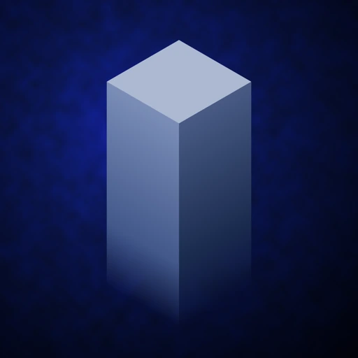 <a href="https://github.com/ARMSX2/ARMSX2">ARMSX2</a>
PlayStation 2 emulator for ARM64 — a free, open-source fork of PCSX2 with native JIT recompilers, for phones, PCs and handhelds.

###  <a href="https://github.com/Lakr233/Asspp">Asspp</a>
The ultimate multi-region App Store manager — switch storefronts instantly and keep an IPA library from any region without signing out.

###  <a href="https://github.com/thebcd69/bcd-games">BCD</a>
Windows games on iPhone and iPad — a fast, controller-friendly launcher with Steam and GOG built in, powered by Wine, FEX and Metal.

###  <a href="https://github.com/XIaodou0416/Beans-Music">Beans Music</a>
使用 SwiftUI 开发的多平台音乐播放器——内置网易云、QQ 与酷狗音乐源，支持本地歌单、离线下载与逐字歌词。

### 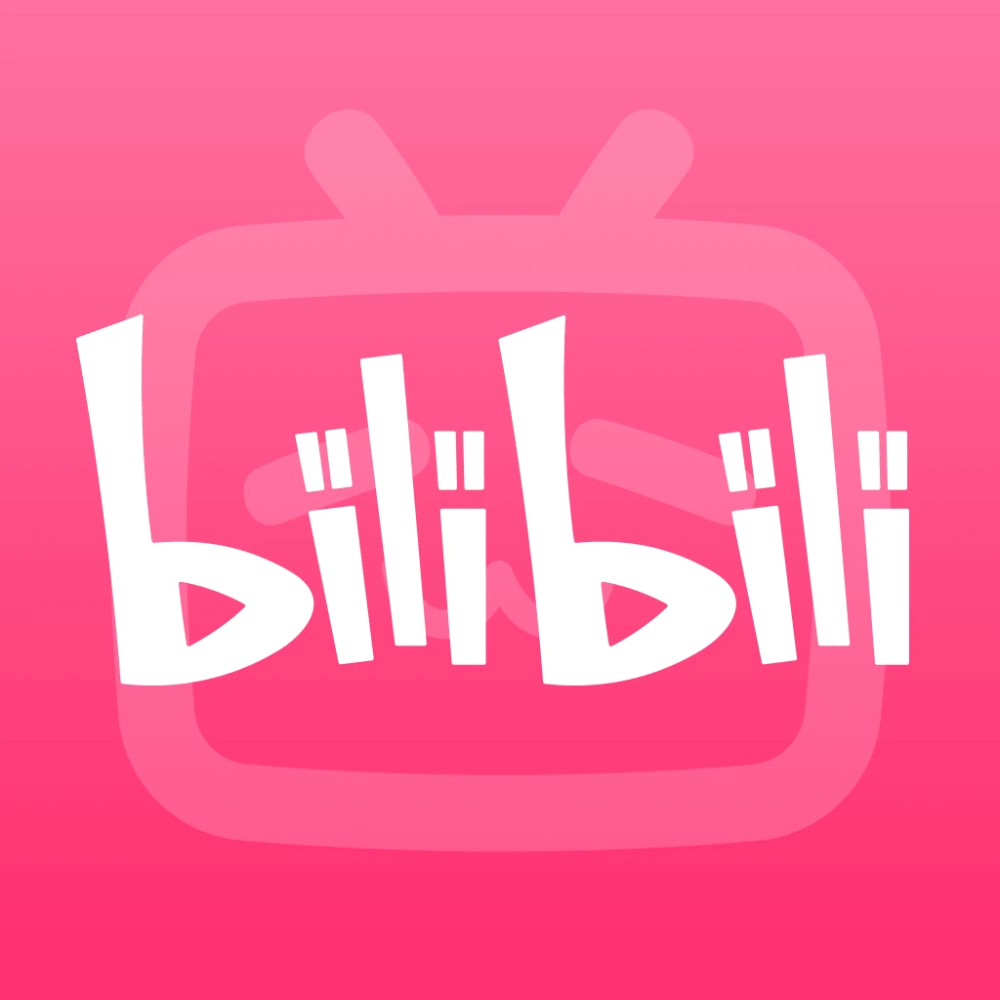 <a href="https://github.com/lcmovie/BiliSponsorBlock-ios">BiliSponsorBlock</a>
官方哔哩哔哩 iOS App 的 SponsorBlock 空降助手插件——自动跳过赞助、自我推广、片头片尾等片段，支持分类独立设置与进度条彩色标记。

### 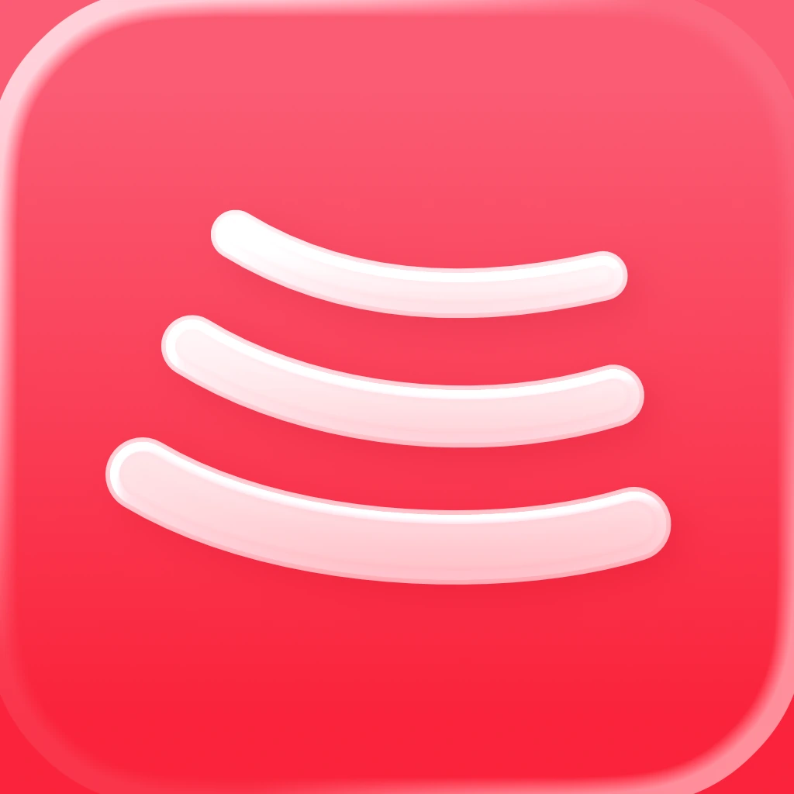 <a href="https://github.com/maanya145/BitChord-iOS">BitChord</a>
Open-source YouTube Music client for iPhone and iPad — a SwiftUI port of BitChord for Android with synced lyrics from a dozen providers, downloads and Automix.

###  <a href="https://github.com/breeze-project-org/Breeze">Breeze</a>
使用 Flutter 开发的插件化漫画阅读器——插件列表已收录 MangaDex、拷贝漫画、漫画柜等数十个图源，并支持本地与云收藏。

###  <a href="https://github.com/moffatman/chan">Chance</a>
Imageboard browser for iOS and Android — a Flutter client with multi-column layout, media gallery, saved threads, filters, and archive support.

###  <a href="https://github.com/mengangs/Cloudn">Cloudn</a>
网盘分享与短视频高速解析下载 — 支持 19+ 网盘、近 50 个短视频与图集平台，解析全部在手机本地完成。

###  <a href="https://github.com/aayush2622/Dartotsu">Dartotsu</a>
Multiplatform anime and manga tracking client — a Flutter rewrite of Dantotsu that syncs AniList, MyAnimeList, Simkl, Kitsu, MangaBaka and MangaUpdates from one library.

###  <a href="https://github.com/AhmedBafkir/DLiPA">DLiPA</a>
Download, install and share App Store IPAs — including older versions — with your own Apple ID, no jailbreak required.

###  <a href="https://github.com/moliango/doer">Doer</a>
A native iOS client for Linux.do.

###  <a href="https://github.com/OatmealDome/dolphin-ios">DolphiniOS</a>
GameCube and Wii emulator for iOS/iPadOS — a port of the Dolphin Emulator, built on the new DolphiniOS codebase.

###  <a href="https://github.com/MaftyManicEMU/DukeX">DukeX</a>
Original Xbox emulation for iOS, built from xemu with a native Swift interface.

### 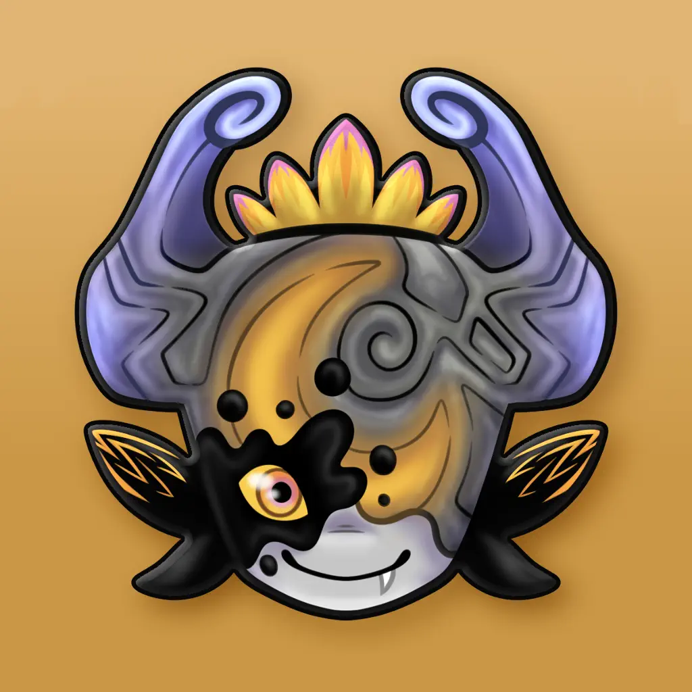 <a href="https://github.com/TwilitRealm/dusklight">Dusklight</a>
A native port of a classic adventure — a reverse-engineered reimplementation of Twilight Princess, with modern rendering and flexible controls. Bring your own game dump.

###  <a href="https://github.com/yangokok886/dylix">Dylix</a>
iPhone / iPad 上的 AI 插件开发工作台——内嵌 Clang / LLD 与 Logos 在设备本机编译 dylib 与 deb，并支持 GitHub / Gitee 同步与二进制分析。

###  <a href="https://github.com/EhPanda-Team/EhPanda">EhPanda</a>
An unofficial E-Hentai App for iOS built with SwiftUI & TCA.

###  <a href="https://github.com/Kianuni/Erosion-CN">Erosion-CN</a>
iOS / iPadOS 系统配置与 MobileGestalt 研究工具箱——基于 worse_query，内置写入安全加固、应用前差异预览与原厂状态恢复。

### 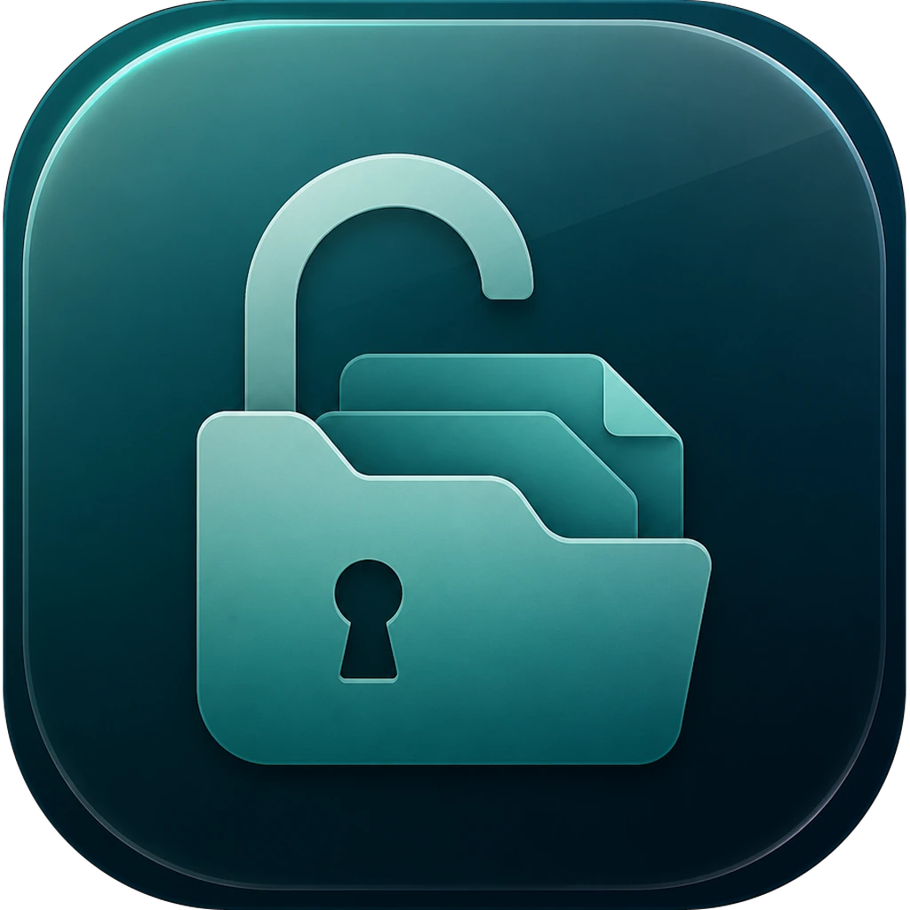 <a href="https://github.com/pwnapplehat/EscapeOS">EscapeOS</a>
On-device file browser and backup tool for another app's Data container — browse, edit, back up and restore Documents, Library and tmp with no jailbreak or Keychain access.

### 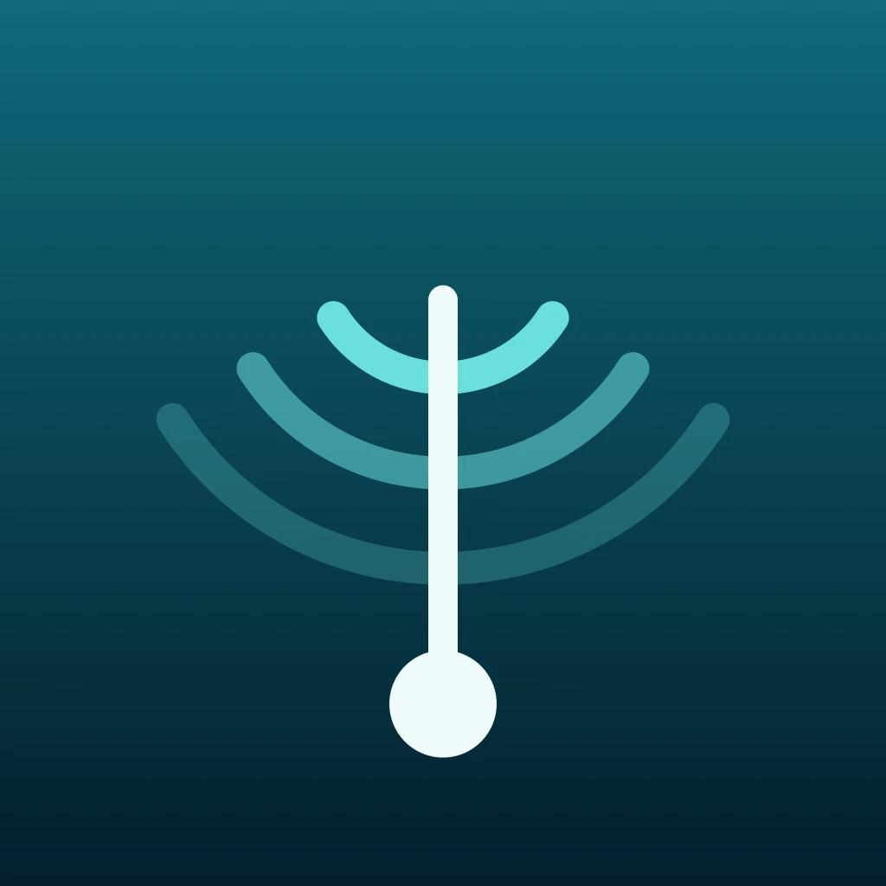 <a href="https://github.com/Leviidev/Fathom">Fathom</a>
x86-64 PC emulator for iOS — runs x86-64 Linux executables by translating them to ARM64 at runtime with FEXCore. Requires JIT and a debugger attached at runtime.

###  <a href="https://github.com/claration/feather">Feather</a>
On-device signing application — sign and install IPAs with your own Apple Developer certificate, no computer needed.

###  <a href="https://github.com/DonutWare/Fladder">Fladder</a>
A cross-platform Jellyfin frontend built on Flutter — stream or sync media to your device, with multiple servers and profiles and Seerr integration.

###  <a href="https://github.com/huamidev/GestaltX">GestaltX</a>
MobileGestalt editor for iOS 27 with region-code tweaks and presets — capability flags and a typed plist field editor, with backups.

###  <a href="https://github.com/owngoal-dev/iGhostVT">Ghost Remote</a>
Open terminals on your other iGhostVT devices — pair with a six-digit code over your local network or a self-hosted relay.

### 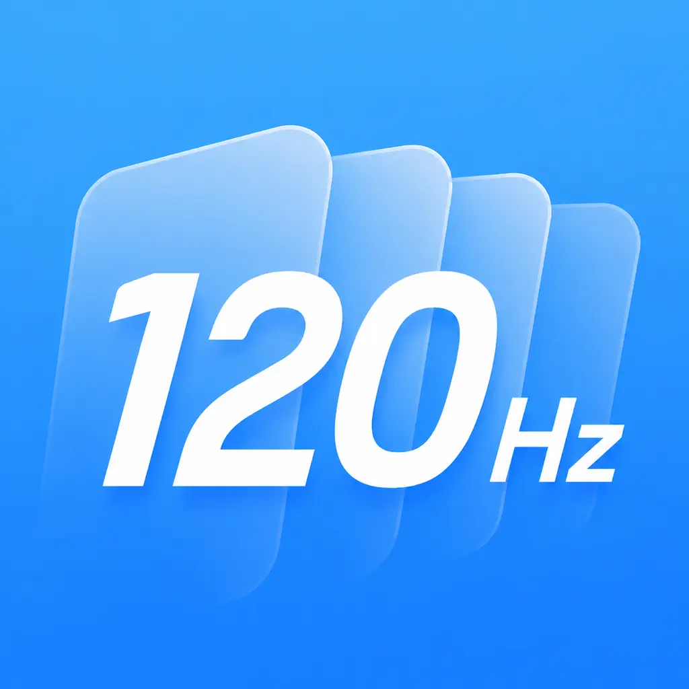 <a href="https://github.com/Yoroin/GlobalRefresh-PiP">GlobalRefresh</a>
基于 iOS 画中画的悬浮窗高刷辅助工具——后台保活与完全隐藏，适配 iOS 15–27。

###  <a href="https://github.com/pookjw/HermesEnabler">HermesEnabler</a>
Enable Hermès Watch Faces on any Apple Watch — plus Ultra faces and on-watch display, sensor and Siri tweaks. Needs watchOS 27.0–27.3 beta 1.

### 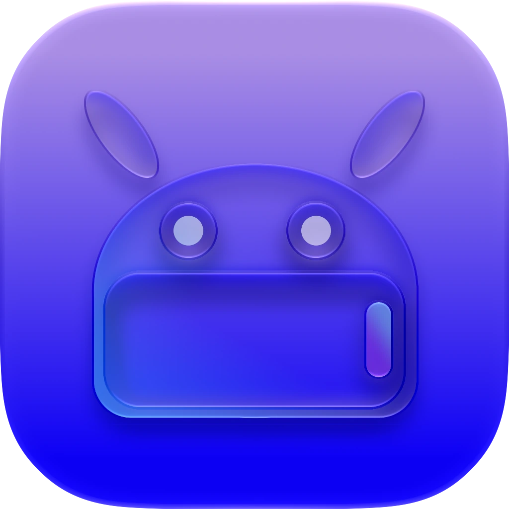 <a href="https://github.com/Leviidev/Husk">Husk</a>
Android app launcher for iOS — drop in an APK, tap it, and the app opens full-screen. JIT and an attached debugger are required.

###  <a href="https://github.com/Absenti/iBuilder">iBuilder</a>
Switch games, built on your iPhone — turns your own game dump into a native iOS build on device. Needs an A14 chip or later, iOS 26.

### 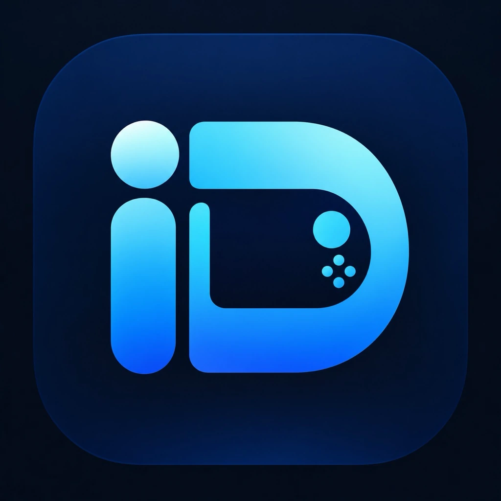 <a href="https://github.com/kuscholar/iDeck">iDeck</a>
Steam Big Picture on iPhone and iPad — runs Valve's client and compatible Windows games locally through Madeira's runtime.

###  <a href="https://github.com/mengangs/ipadn">iPadn</a>
下载 App Store 的历史版本与已下架应用——搜索并安装你已拥有的应用，支持区域价格比较与 11 种语言。

### 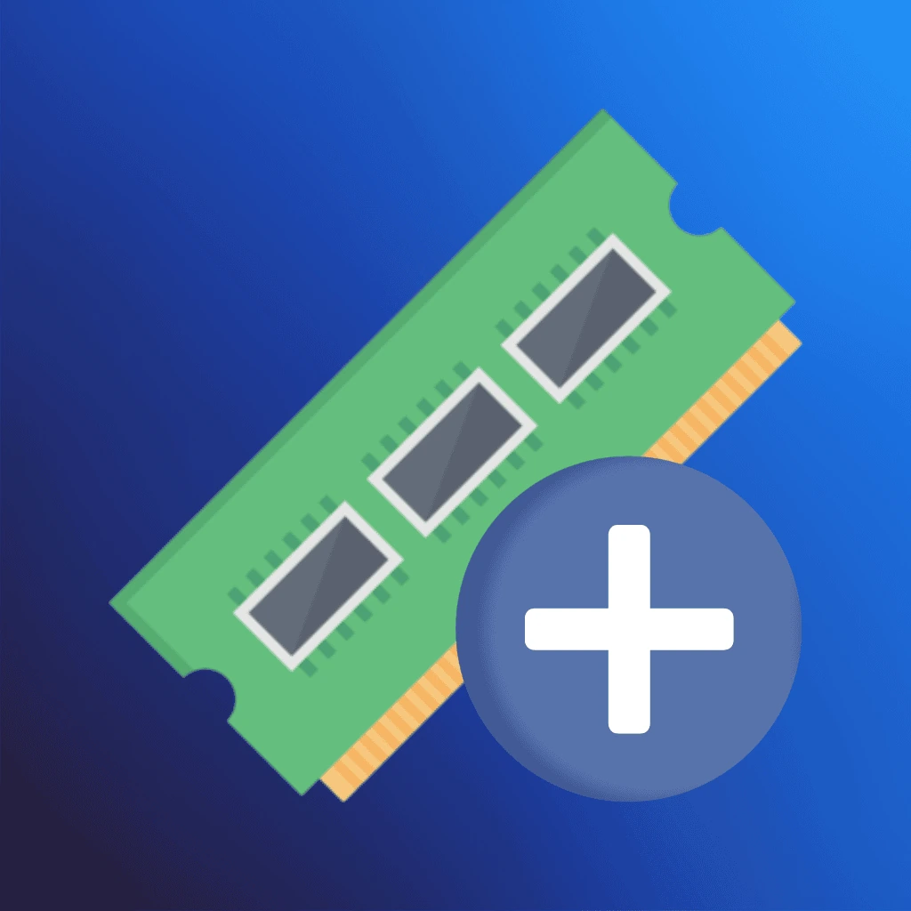 <a href="https://github.com/NexSideloading/iRAM-Plus">iRAM+</a>
Enable Increased Memory Limit for sideloaded apps on device — sign in with the Apple Account that signed them, add the entitlement, then reinstall. Apple-account signatures only.

###  <a href="https://github.com/intraducine/iridium">Iridium</a>
Experimental Windows-game runtime for iPhone and iPad — one library for the games you own, played with touch, a controller or a keyboard.

###  <a href="https://github.com/XITRIX/iTorrent">iTorrent</a>
Torrent client for iOS.

###  <a href="https://github.com/Predidit/Kazumi">Kazumi</a>
基于自定义规则的番剧采集APP，支持流媒体在线观看、弹幕与实时超分辨率，使用 Flutter 实现。

###  <a href="https://github.com/LinkPass888/Kazumi-Swift">Kazumi-Swift</a>
基于自定义规则的番剧采集APP，支持流媒体在线观看、弹幕与实时超分辨率，使用 SwiftUI 实现。

###  <a href="https://github.com/Mac-XK/KMusic">KMusic</a>
基于 SwiftUI 的多源音乐聚合播放器，支持 iOS/macOS，内置酷我、酷狗、QQ 音乐、网易云等多平台音源与 LRC 歌词同步。

### 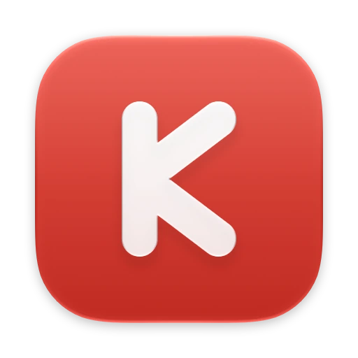 <a href="https://github.com/missuo/kumone">Kumone</a>
原生 NetEase Cloud Music iOS 客户端（雲の音），直连网易云音乐真实 API，支持灰色歌曲解锁与歌词。

###  <a href="https://github.com/LightNovelShelf/Flutter">LightNovelShelf</a>
轻书架官方 Flutter 客户端，支持书架管理、在线阅读与翻页动画。

###  <a href="https://github.com/mxhm11cr/LinuxRunner">LinuxRunner</a>
Run ARM64 Linux apps and desktops on iOS — no jailbreak, no virtual machine, no JIT; full desktops can use an external display.

###  <a href="https://github.com/LiveContainer/LiveContainer">LiveContainer+SideStore</a>
Run iOS apps without actually installing them! This build bundles SideStore for refreshing your apps.

###  <a href="https://github.com/lpfoj/lsx4">LSX4</a>
Open-source PS4/PS5 emulator — the current iOS build plays PS4 games and needs iOS 26+ with JIT.

###  <a href="https://github.com/willfaust/Madeira">Madeira</a>
Windows PC games on your iPhone — unmodified x86-64 games run through Wine, FEX-Emu and Metal, no jailbreak.

###  <a href="https://github.com/kodjodevf/mangayomi">Mangayomi</a>
Read manga, novels, and watch anime.

###  <a href="https://github.com/Manic-EMU/ManicEMU">ManicEMU</a>
All-in-one retro game emulator for iOS, with a clean interface and broad platform support.

###  <a href="https://github.com/EPXiaohua/MD3Music-iOS">MD3Music</a>
基于酷狗音乐 API 的 Material 3 音乐播放器 — 内置嵌入式 Rust API 服务器，支持逐字歌词与多种音频输出。

###  <a href="https://github.com/youshen2/MeloX">MeloX</a>
使用 SwiftUI 开发的网易云音乐第三方客户端——面向 iPhone、iPad、Mac 与 Apple Watch 的原生播放器。

###  <a href="https://github.com/jxxghp/MoviePilot-App">MoviePilot</a>
MoviePilot 的 iOS 原生客户端——系统原生导航、搜索与快捷面板，业务页面复用 MoviePilot-Frontend，需要 iOS 16+ 和自有 MoviePilot 实例。

###  <a href="https://github.com/singleton-altman/MoviePilotLite">MoviePilotLite</a>
MoviePilot 移动端，基于 Flutter 实现。

###  <a href="https://github.com/dddevid/Musly">Musly</a>
Free Navidrome client & Subsonic music player with an Apple Music-inspired interface.

### 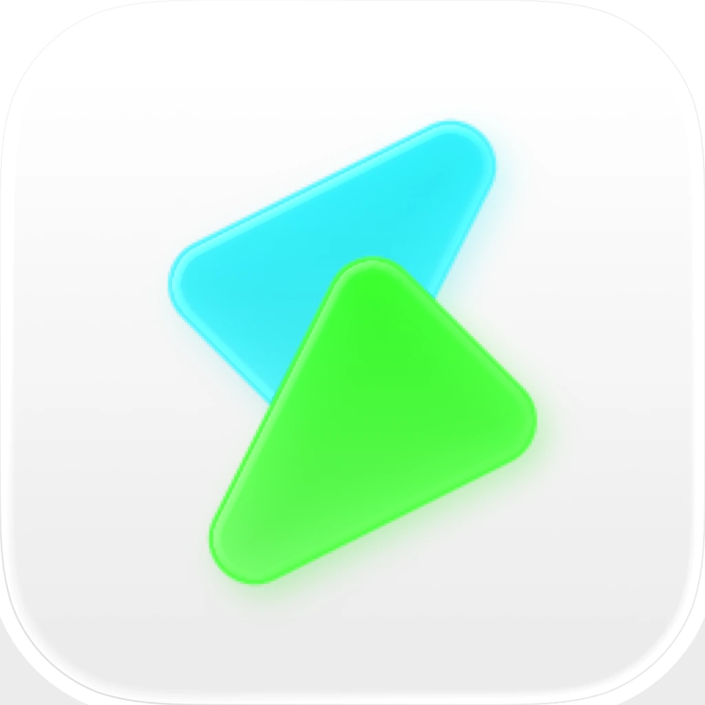 <a href="https://github.com/ResistanceTo/MiniWatts">MiniWatts</a>
Battery, charging and thermal instrument — what the charger delivers, how much reaches the cell, where the rest goes as heat, and every temperature sensor.

###  <a href="https://github.com/coflyn/Mori">Mori</a>
Client-side media downloader for 16 platforms — watermark-free videos, photos and audio saved on-device, with a built-in stream sniffer, audio extractor and PDF tools.

###  <a href="https://github.com/mornyeapp/Mornye">Mornye</a>
Hi-res music player with downloads — a Flutter and Rust player with bit-perfect output, synced lyrics and streaming from SMB, WebDAV or Subsonic.

###  <a href="https://github.com/NuvioMedia/NuvioMobile">Nuvio</a>
Open-source media client for your own sources — artwork, ratings, subtitles and your place saved across phone, desktop and TV.

###  <a href="https://github.com/verback2308/Opaline">Opaline</a>
YouTube client for iOS 12+ — lightweight and privacy-focused, with SponsorBlock, Return YouTube Dislike and up to 1080p playback.

###  <a href="https://github.com/nekohasekai/open-screen-sharing">Open Screen Sharing</a>
Remote desktop client optimized for Mac screen sharing — also speaks standard VNC and RDP.

###  <a href="https://github.com/hugeBlack/OpenParsec">OpenParsec</a>
Open Parsec client for iOS/iPadOS — open source, with mouse, keyboard and touch-screen support.

###  <a href="https://github.com/huami1314/orca-ios">Orca</a>
iPhone client for Orca, the agent development environment — chat with agents, follow their tool calls in a built-in Ghostty terminal and keep a session in Picture in Picture from your phone, paired with Orca on your Mac.

###  <a href="https://github.com/MakrSas/orchard-ios">Orchard</a>
Apple Silicon macOS Ventura running inside an iPhone app — a real arm64 guest booted through Apple's own chain, drawn through Metal.

###  <a href="https://github.com/bggRGjQaUbCoE/PiliPlus">PiliPlus</a>
使用Flutter开发的BiliBili第三方客户端。

###  <a href="https://github.com/Eslzzyl/Pixiv-SwiftUI">Pixiv-SwiftUI</a>
基于 SwiftUI 的 Pixiv 第三方客户端，支持 iOS/iPadOS/macOS。

###  <a href="https://github.com/playportdev/playport">Playport</a>
PC games on your iPhone. Natively, no streaming — 64-bit and 32-bit Windows games run on the phone's own CPU and GPU.

### 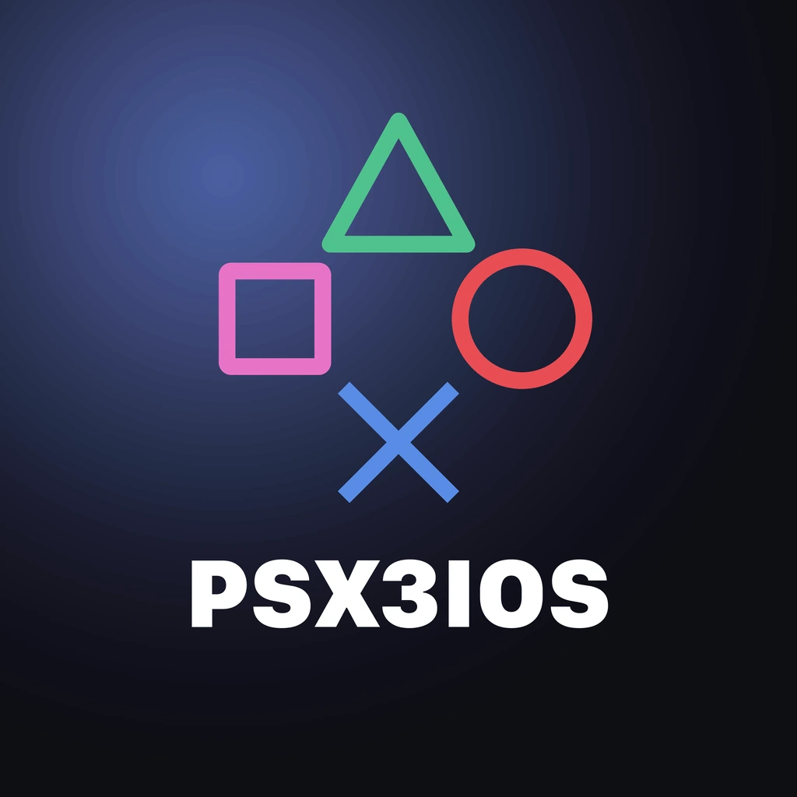 <a href="https://github.com/xmiguel911x/PSX3IOS">PSX3IOS</a>
PlayStation 3 emulator for iPhone and iPad — built on RPCS3, with community patches, trophies, play time and save data.

###  <a href="https://github.com/liuchuancong/pure_live">PureLive</a>
基于 Flutter 的开源多平台直播聚合播放器，支持 Bilibili、虎牙、斗鱼、快手、抖音、网易 CC、Twitch 及自定义 M3U/M3U8 直播源。

###  <a href="https://github.com/TarbleFR/RewindBox">RewindBox</a>
Emulation frontend for iPhone and iPad — a NeoStation fork pairing a console-style library with Libretro cores, Dolphin, ARMSX2, MeloNX and RPCS3.

###  <a href="https://github.com/iam567/rich4-renew-app">Rich4Renew</a>
大富翁4 高清重制版，新增歌舞伎町地图与大富豪模式 — Vite + TypeScript 重写的游戏本体，Capacitor 打包成 iOS App，规则依原版反组译还原。

###  <a href="https://github.com/ekomlenovic/rush_hour_ios_android">Rush Hours</a>
Slide the cars, free the red one. A free sliding-block puzzle with 700+ levels on a world map, daily and weekly challenges, a level creator and multiplayer.

###  <a href="https://github.com/faroukbmiled/RyukSign">RyukSign</a>
On-device iOS app signer and installer — a Feather fork with a tweak manager, WebDAV file transfer and background downloads.

###  <a href="https://github.com/donbytyqi/scenebox">SceneBox</a>
Torrent streaming client for iOS, iPadOS, tvOS and Mac (Catalyst), written in SwiftUI.

###  <a href="https://github.com/xibrox/Shirox">Shirox</a>
Personal anime and manga library manager for iOS — track with AniList and MyAnimeList, and play from your own sources on iPhone, iPad and Mac.

###  <a href="https://github.com/SideStore/SideStore">SideStore</a>
Untethered alternative app store for iOS — resigns and installs IPAs with your own Apple ID and refreshes them in the background, no AltServer.

### 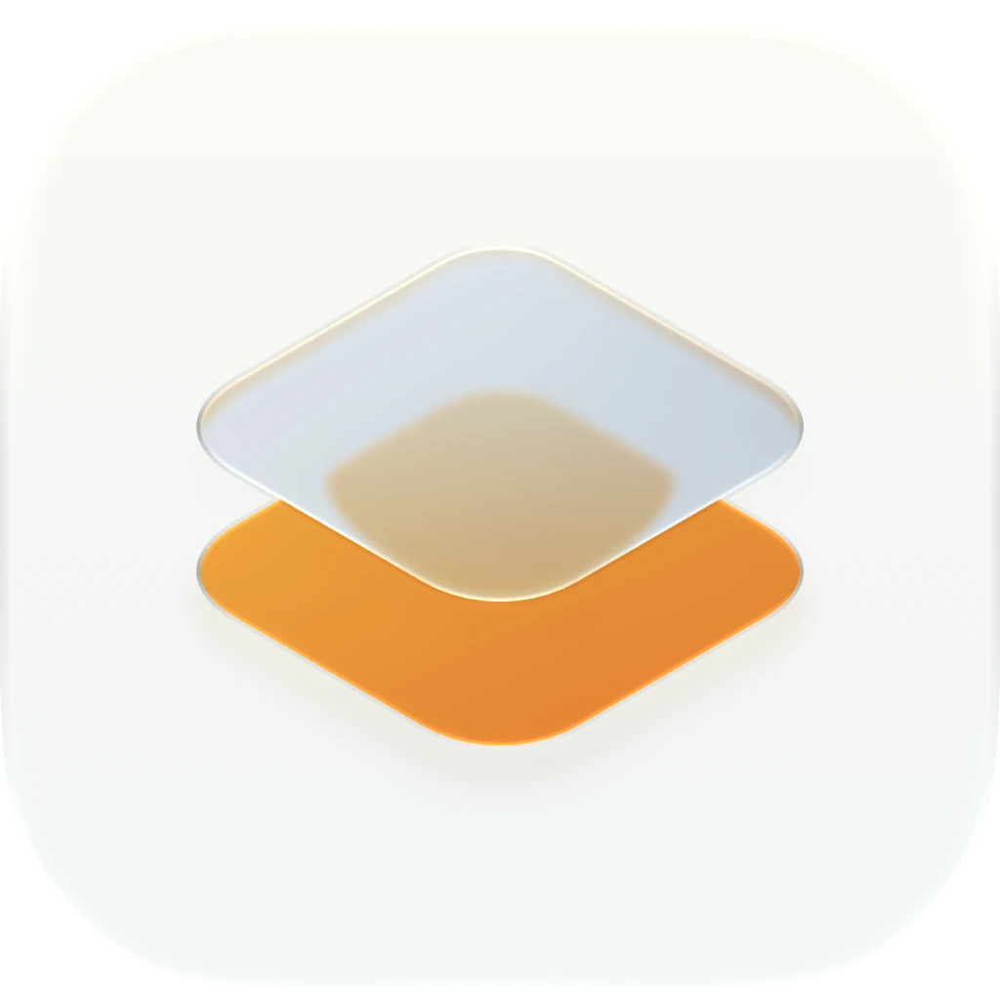 <a href="https://github.com/akinal5765-byte/Silverphase">Silverphase</a>
面向 iPhone 与 iPad 的原生胶片与印相模拟器——选好胶片与相纸，再从曝光、显影一路塑形到扫描。

###  <a href="https://github.com/June6699/dart_simple_live">Simple Live</a>
支持弹幕与 IPTV 的开源多平台直播聚合播放器——基于 Flutter，同一套代码覆盖手机、桌面与电视端。

###  <a href="https://github.com/ishtiaq156/stats">Stats</a>
Your Mac's activity, at a glance — a local-first system monitor over an encrypted local connection, with a lightweight Mac companion.

### 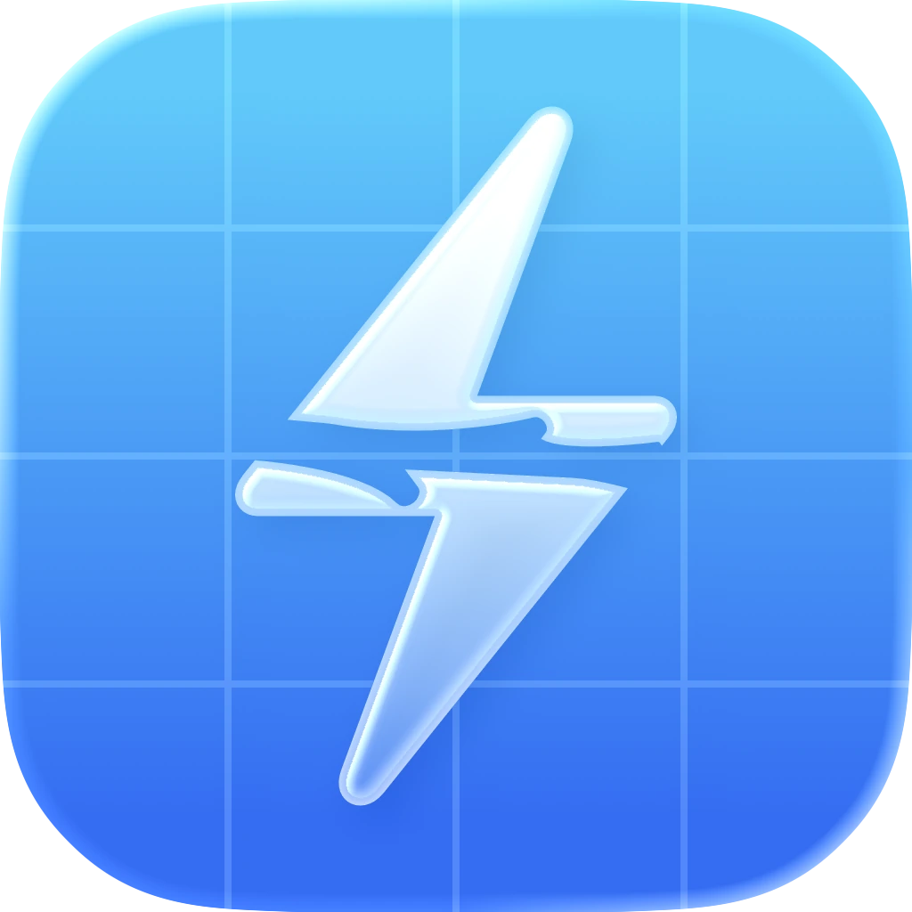 <a href="https://github.com/StikDebug/StikDebug">StikDebug</a>
On-device JIT enabler and device toolbox for iOS 17.4+, built on idevice.

###  <a href="https://github.com/swipt-automation/swipt">Swipt</a>
The universal iOS automation platform — JavaScript swiplets, a TypeScript SDK and an MCP-compatible API.

###  <a href="https://github.com/ndgthuan/tdrive">TDrive</a>
Turn your private Telegram storage into a cloud drive — browse, search, preview and mount files kept in your own Telegram account.

###  <a href="https://github.com/infinityf4p/TiebaPure-iOS">TiebaPure</a>
基于 SwiftUI 的第三方百度贴吧客户端——支持 iOS 16.4+，可浏览、搜索、收藏、查看媒体与本地阅读记录。

###  <a href="https://github.com/Suwayomi/Suwayomi-Tsumiru">Tsumiru</a>
Native manga & manhwa reader for Suwayomi-Server — offline downloads with an on-device catalogue and a rebuilt continuous-scroll webtoon reader.

### 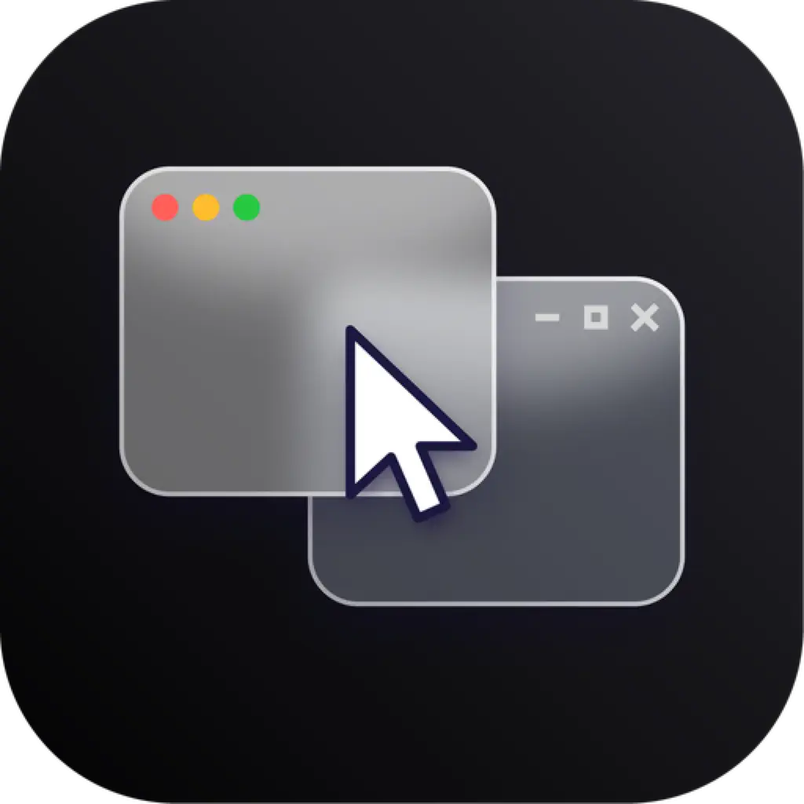 <a href="https://github.com/InukaAsith/TwinDesk">TwinDesk</a>
Your iPhone and your computers as one desk — screens, files, clipboard, notifications, camera and one mouse and keyboard, over Wi-Fi, USB or Bluetooth.

###  <a href="https://github.com/utmapp/UTM">UTM</a>
Virtual machines for iOS — run Windows, Android and more on your iPhone or iPad, with 30+ processors and JIT-backed emulation.

###  <a href="https://github.com/CyrilPeng/Venera-Next">VeneraNext</a>
跨平台漫画阅读器——基于 Flutter，支持本地漫画、WebDAV 漫画源与第三方网络漫画源。

###  <a href="https://github.com/vrcm-team/VRCM">VRCM</a>
Bring your VRChat social life to your phone — friend network, shared history, two-way VRChat+ Gallery and meetup name cards.

###  <a href="https://github.com/kolbicz/WQFiles">WQ Files</a>
File manager for iOS 26 and 27 (worse_query) — browse other apps' containers, edit plists, hex and SQLite, and back up or clear app data, no jailbreak.

### 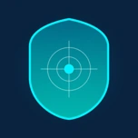 <a href="https://github.com/Kianuni/WQGuard">WQGuard</a>
iOS 沙盒越权检测与侧载 IPA 审查工具——面向 iOS 26.2+ / iOS 27.x 的只读沙盒逃逸检测、Mach-O 静态审计与固件 CVE 防护。

###  <a href="https://github.com/hseons/WQManager">WQManager</a>
无需越狱的 App 数据备份与缓存清理工具 — 备份可导出为 `.wqbackup` 包，恢复写前自动安全备份、写后哈希校验与失败回滚，清理只动所选 App 的缓存与临时目录。

###  <a href="https://github.com/MchinaMd57764/WQToolkit">WQToolkit</a>
File browser and maintenance panel for your own app containers — browse, clean and inspect your data and App Groups without a jailbreak.

###  <a href="https://github.com/suversal/WrapPin">WrapPin</a>
本机虚拟定位与步行路线测试工具 — 通过设备配对在 iPhone 上固定位置、模拟步行或驾车路线，停止时恢复真实位置。

###  <a href="https://github.com/mrdrvt99/YouProEXTRA">YouProEXTRA</a>
YouTube mod with customizable tweaks — YouPro, YTLite and other modules bundled into one IPA builder.

###  <a href="https://github.com/huamurui/zhihu-minus-minus">ZhihuMinusMinus</a>
轻量、纯净的第三方知乎客户端，基于 React Native (Expo) 构建，无广告，支持多账号切换、游客模式与深色模式。

## Project Layout

```
AltGallery/
├── assets/               # shared assets: app icon, "Add AltSource" button, README screenshots
│   ├── icon.svg / icon.png
│   ├── add-alt-source.svg / add-alt-source.png
│   └── *.jpg             # README screenshots (SideStore, SideStore News, LiveContainer)
├── tools/                # helper scripts (uv scripts; run with `uv run tools/<name>.py`)
│   ├── render_news.py    # shared news-image renderer
│   ├── ipa_icon.py       # extract the app icon from a release .ipa
│   └── ipa_bundle_id.py  # read bundle id / version from a release .ipa
├── apps/                 # one folder per app
│   └── <AppName>/
│       ├── config.toml   # altgen configuration
│       ├── news.toml     # news image config (name, tagline, optional colors)
│       ├── icon.png      # resource files live here
│       ├── images/       # screenshots + news.webp promo image
│       └── apps.json     # generated AltStore source
└── ...
```

## Star History

<a href="https://www.star-history.com/?repos=bebound%2Faltgallery&type=date&legend=top-left">
 <picture>
   <source media="(prefers-color-scheme: dark)" srcset="https://api.star-history.com/chart?repos=bebound/altgallery&type=date&theme=dark&legend=top-left" />
   <source media="(prefers-color-scheme: light)" srcset="https://api.star-history.com/chart?repos=bebound/altgallery&type=date&legend=top-left" />
   
 </picture>
</a>
