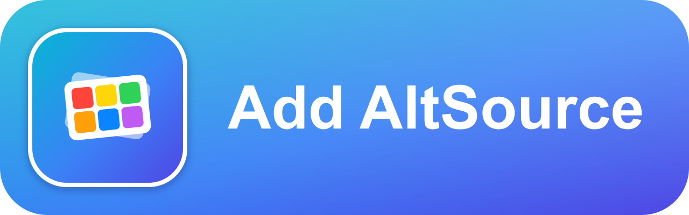
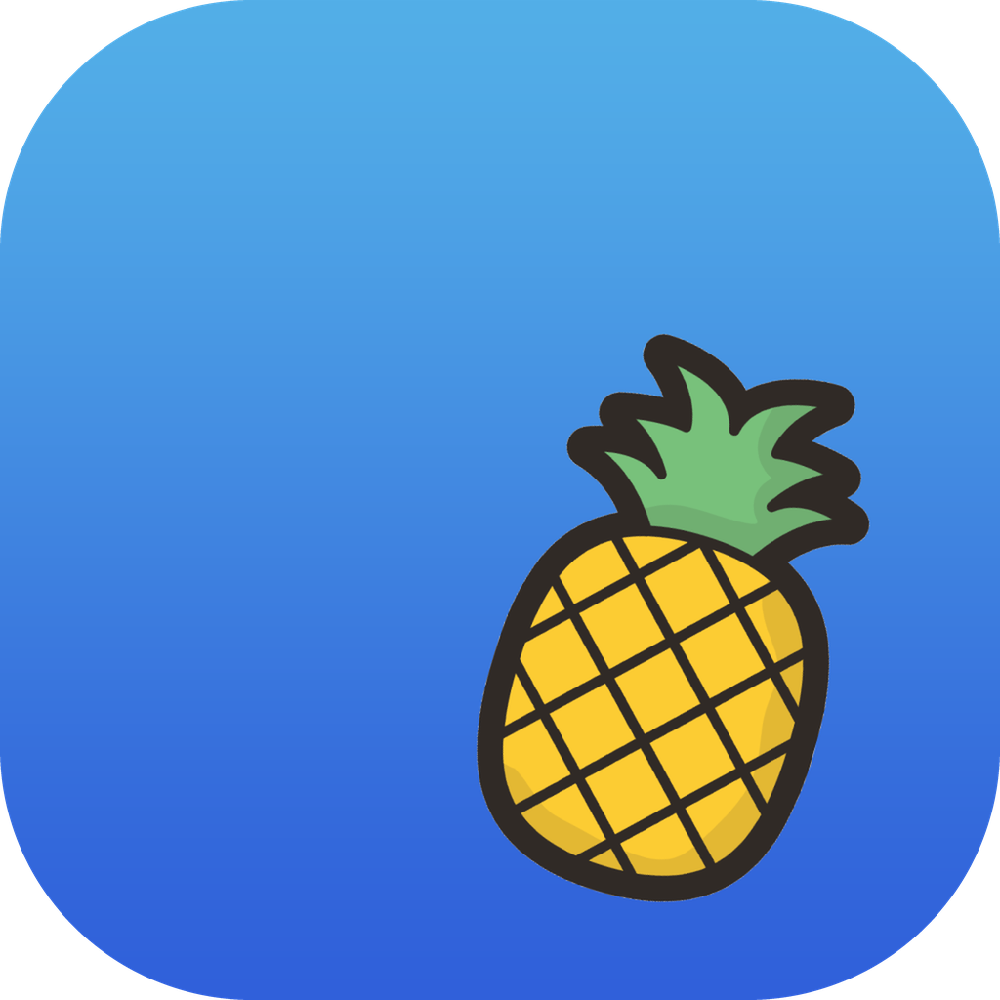
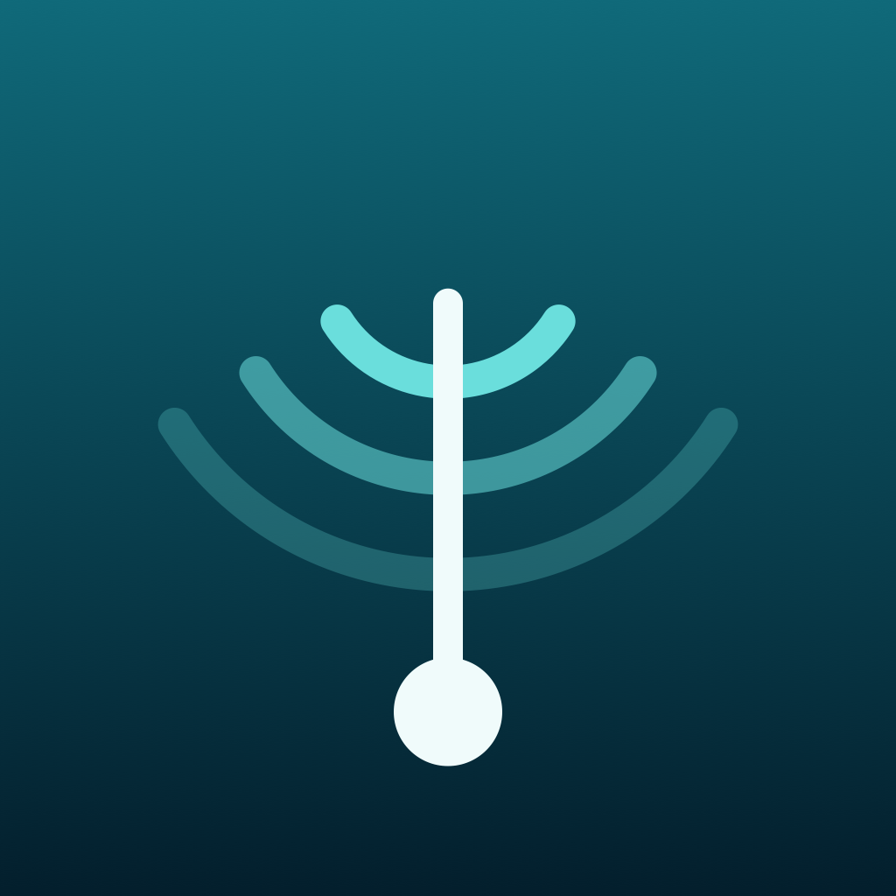
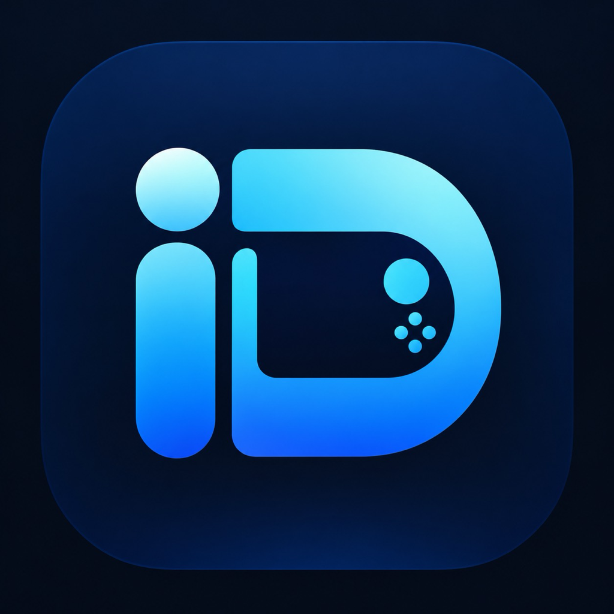
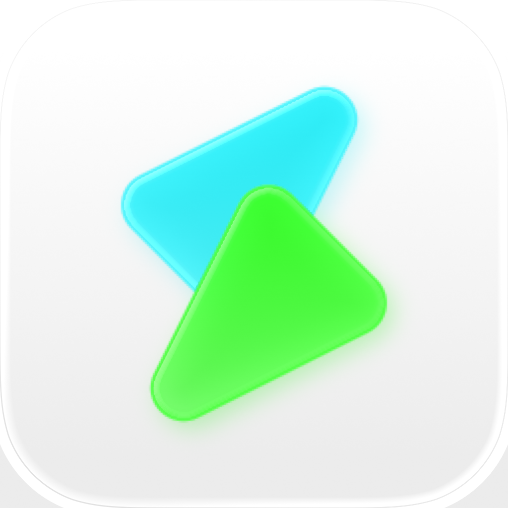
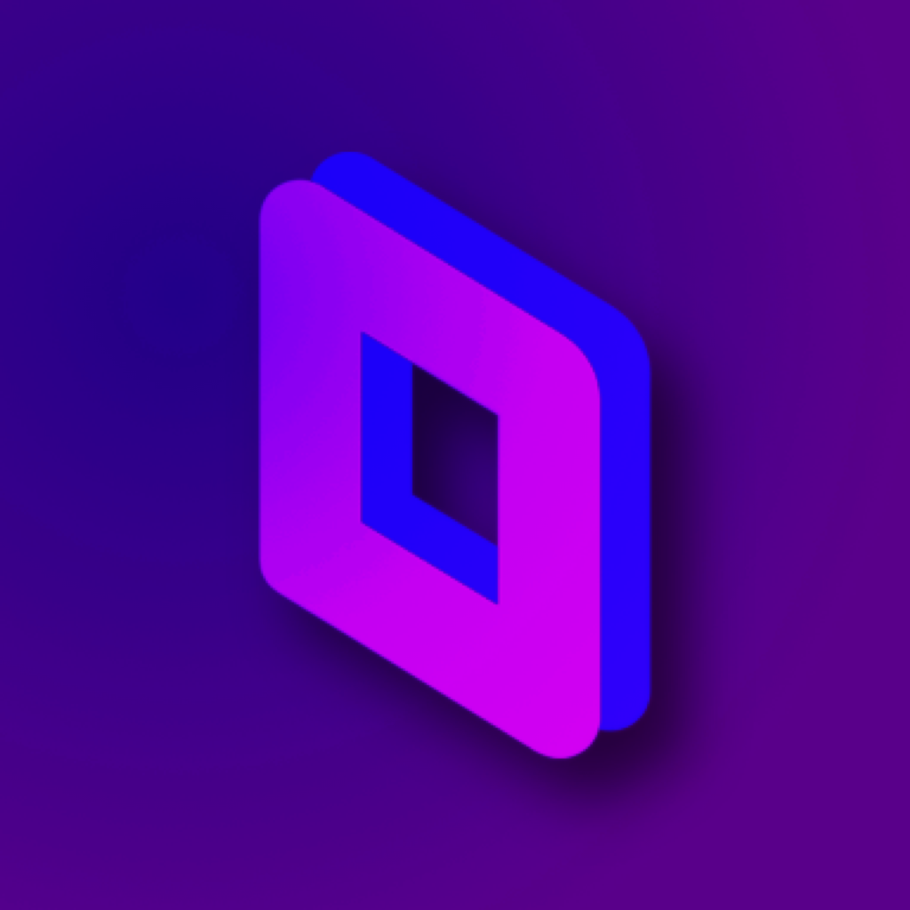
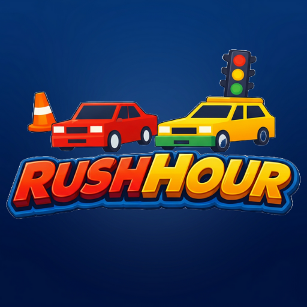
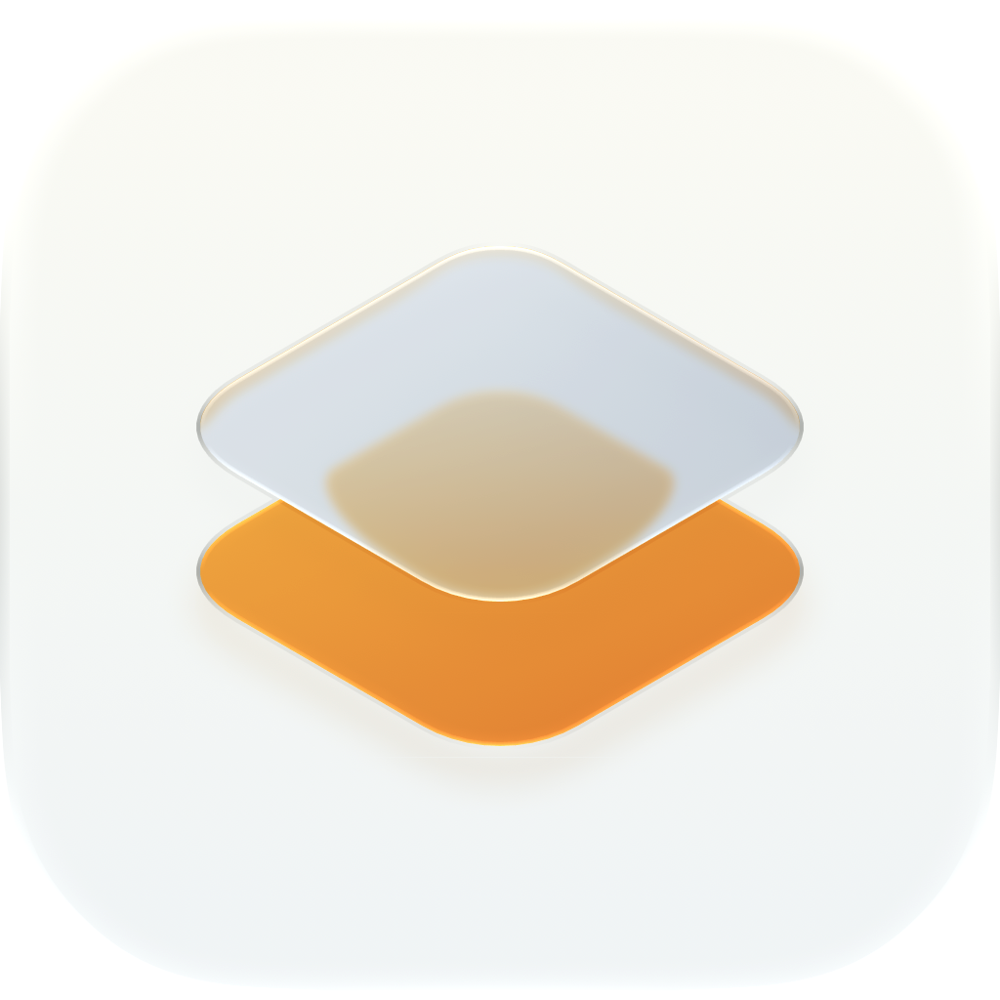
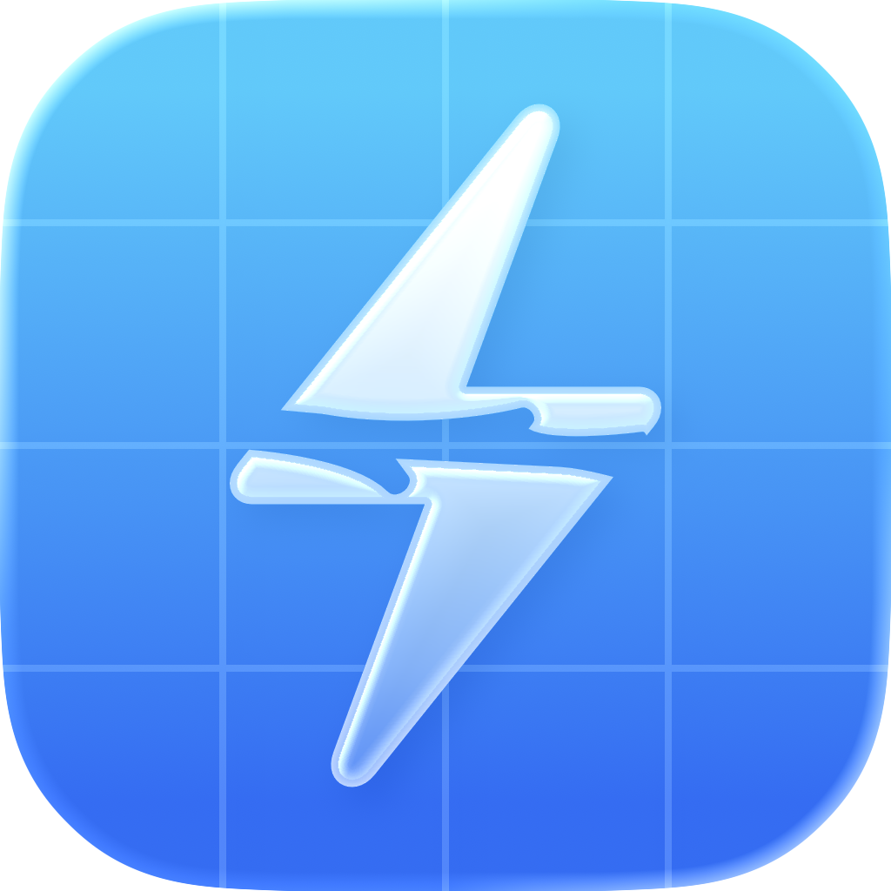
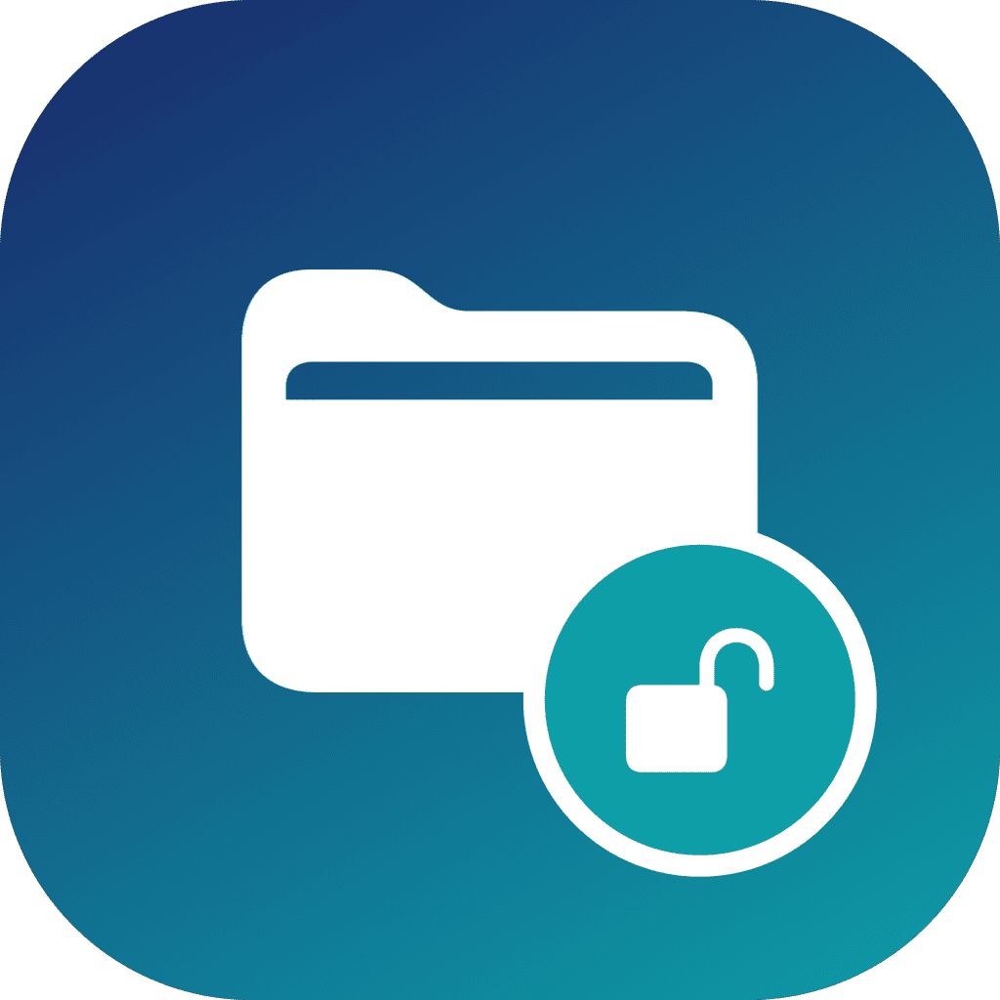

<p align="center">
  
</p>

<h1 align="center">AltGallery</h1>

<p align="center"><b>English</b> | <a href="README_CN.md">简体中文</a></p>

<p>Curated AltStore sources for IPA projects on GitHub. All sources are generated with <a href="https://github.com/bebound/AltGen">AltGen</a>. It can be used with <a href="https://github.com/altstoreio/Altstore">AltStore</a>, <a href="https://github.com/SideStore/SideStore">SideStore</a>, <a href="https://github.com/LiveContainer/LiveContainer">LiveContainer</a>, <a href="https://github.com/claration/Feather">Feather</a> or other compatible apps.</p>

<p>Browse the AltGallery in your browser: <a href="https://altgallery.fromkk.com/">altgallery.fromkk.com</a></p>

<p align="center">
<a href="https://altdirect.app/?url=https://raw.githubusercontent.com/bebound/AltGallery/refs/heads/master/all-apps.json" target="_blank">

</a>
</p>
<p align="center">(Click the above image to add the all-in-one AltGallery source. Individual app sources live in the <code>apps</code> folder.)</p>
<p align="center">Can't reach <code>github.com</code>? Use the <a href="https://altdirect.app/?url=https://gh-proxy.com/https://raw.githubusercontent.com/bebound/AltGallery/refs/heads/master/all-apps-proxy.json" target="_blank">gh-proxy mirror</a> instead — the resources all go through gh-proxy.com.</p>

## Request an App

Don't see an app you want? [Create an issue](https://github.com/bebound/AltGallery/issues/new) and I'll add it to the gallery. Please include the app's name and a link to its GitHub repo (or an IPA / release URL) so I can verify and add it.

## Screenshots

<table align="center" style="border: none; margin-left: auto; margin-right: auto;">
  <tr>
    <td align="center" style="border: none; padding: 6px;">
      
      <br><b>SideStore</b>
    </td>
    <td align="center" style="border: none; padding: 6px;">
      
      <br><b>SideStore News</b>
    </td>
    <td align="center" style="border: none; padding: 6px;">
      
      <br><b>LiveContainer</b>
    </td>
  </tr>
</table>

## Available Apps

###  <a href="https://github.com/Aidoku/Aidoku">Aidoku</a>
A free and open source manga reading application for iOS and iPadOS.

###  <a href="https://github.com/Mak5er/AirCard-iOS">AirCard-iOS</a>
Customize Apple Wallet card artwork, passcode dialers and PosterBoard wallpapers on device without a jailbreak.

###  <a href="https://github.com/altstoreio/AltStore">AltStore</a>
The original alternative app store for non-jailbroken iOS devices — sideload non-notarized IPAs with AltServer on a Mac or PC.

###  <a href="https://github.com/AniBakaBaka/AniBaka">AniBaka</a>
跨平台番剧聚合与弹幕客户端，多番剧源、多弹幕、高清无广告，支持动漫实时超分辨率。

###  <a href="https://github.com/openAnimeFlow/AnimeFlow">AnimeFlow</a>
跨平台动漫视频播放器，支持多数据源、实时 4K 超分辨率、Bangumi 同步与弹幕。

###  <a href="https://github.com/open-ani/animeko">Animeko</a>
一站式弹幕追番平台，支持 Bangumi 云同步、多视频数据源聚合、离线缓存与弹幕云过滤。

###  <a href="https://github.com/Apollo-Reborn/Apollo-Reborn">Apollo Reborn</a>
A community-maintained iOS tweak that keeps Apollo for Reddit working after its June 2023 shutdown.

###  <a href="https://github.com/ARMSX2/ARMSX2">ARMSX2</a>
A native ARM64 PlayStation 2 emulator for iOS and iPadOS, forked from PCSX2.

###  <a href="https://github.com/Lakr233/Asspp">Asspp</a>
Manage multiple Apple IDs across App Store regions — browse, download and keep official IPAs from any region without signing out.

###  <a href="https://github.com/thebcd69/bcd-games">BCD</a>
Run Windows games on iPhone and iPad — a fast, controller-friendly launcher with Steam and GOG built in, powered by Wine, FEX and Metal.

###  <a href="https://github.com/AhmedBafkir/DLiPA">DLiPA</a>
Search the App Store, download any app as an IPA, including older versions, and install or share it with your Apple ID — no jailbreak required.

###  <a href="https://github.com/moliango/doer">Doer</a>
A native iOS client for Linux.do.

###  <a href="https://github.com/OatmealDome/dolphin-ios">DolphiniOS</a>
Dolphin for iOS, reborn — a GameCube and Wii emulator for iPhone and iPad.

###  <a href="https://github.com/MaftyManicEMU/DukeX">DukeX</a>
Original Xbox emulation for iOS, built from xemu with a native Swift interface.

###  <a href="https://github.com/EhPanda-Team/EhPanda">EhPanda</a>
An unofficial E-Hentai App for iOS built with SwiftUI & TCA.

###  <a href="https://github.com/Kianuni/Erosion-CN">Erosion-CN</a>
Simplified-Chinese Erosion fork — a MobileGestalt and system-config toolbox for iOS 27 with hardened writes, pre-apply diffs and factory-state restore. Needs an App Group when re-signing.

###  <a href="https://github.com/Leviidev/Fathom">Fathom</a>
An x86-64 PC emulator for iOS — runs x86-64 Linux executables by translating them to ARM64 at runtime with FEXCore. Requires JIT and a debugger attached at runtime.

###  <a href="https://github.com/claration/feather">Feather</a>
Free on-device iOS/iPadOS signer and app manager — sign and install IPAs with your own Apple Developer certificate, no computer needed.

###  <a href="https://github.com/huamidev/GestaltX">GestaltX</a>
Edit MobileGestalt on iOS 27 — region-code tweaks, device presets and capability flags, with backups and a typed plist field editor.

###  <a href="https://github.com/pookjw/HermesEnabler">HermesEnabler</a>
Enable Hermès and Ultra watch faces on any Apple Watch, plus on-watch display, sensor and Siri tweaks. Requires watchOS 27.0–27.3 beta 1 and a paid Apple Developer account.

###  <a href="https://github.com/Leviidev/Husk">Husk</a>
Run Android apps on iOS — drop in an APK, tap it, and it opens full-screen. Requires JIT and a debugger attached at runtime.

###  <a href="https://github.com/kuscholar/iDeck">iDeck</a>
Run Steam Big Picture and compatible Windows PC games on iPhone and iPad through Madeira’s experimental local runtime.

###  <a href="https://github.com/mengangs/ipadn">iPadn</a>
Search, download and install the apps you own on iPhone and iPad — older versions, removed apps, regional prices and native install.

###  <a href="https://github.com/intraducine/iridium">Iridium</a>
An experimental iPhone and iPad Windows-game runtime, with a native game library and touch, keyboard, mouse, and controller integration.

###  <a href="https://github.com/XITRIX/iTorrent">iTorrent</a>
Torrent client for iOS.

###  <a href="https://github.com/Predidit/Kazumi">Kazumi</a>
基于自定义规则的番剧采集APP，支持流媒体在线观看、弹幕与实时超分辨率，使用 Flutter 实现。

###  <a href="https://github.com/LinkPass888/Kazumi-Swift">Kazumi-Swift</a>
基于自定义规则的番剧采集APP，支持流媒体在线观看、弹幕与实时超分辨率，使用 SwiftUI 实现。

###  <a href="https://github.com/Mac-XK/KMusic">KMusic</a>
基于 SwiftUI 的多源音乐聚合播放器，支持 iOS/macOS，内置酷我、酷狗、QQ 音乐、网易云等多平台音源与 LRC 歌词同步。

###  <a href="https://github.com/missuo/kumone">Kumone</a>
原生 NetEase Cloud Music iOS 客户端（雲の音），直连网易云音乐真实 API，支持灰色歌曲解锁与歌词。

###  <a href="https://github.com/LightNovelShelf/Flutter">LightNovelShelf</a>
轻书架官方 Flutter 客户端，支持书架管理、在线阅读与翻页动画。

###  <a href="https://github.com/mxhm11cr/LinuxRunner">LinuxRunner</a>
Run ARM64 Linux applications and desktop environments on iOS without a jailbreak, virtual machine, or JIT.

###  <a href="https://github.com/LiveContainer/LiveContainer">LiveContainer+SideStore</a>
An app launcher that runs iOS apps without actually installing them, with a built-in SideStore for refreshing your apps.

###  <a href="https://github.com/lpfoj/lsx4">LSX4</a>
An open-source PlayStation 4/5 emulator for iOS; the current iOS build supports PS4 gameplay and requires iOS 26+ with JIT.

###  <a href="https://github.com/willfaust/Madeira">Madeira</a>
Run unmodified x86-64 Windows PC games on iPhone through Wine, FEX-Emu and Metal — no jailbreak.

###  <a href="https://github.com/kodjodevf/mangayomi">Mangayomi</a>
Read manga, novels, and watch anime.

###  <a href="https://github.com/Manic-EMU/ManicEMU">ManicEMU</a>
All-in-one retro game emulator for iOS, with a clean interface and broad platform support.

###  <a href="https://github.com/youshen2/MeloX">MeloX</a>
原生 SwiftUI 网易云音乐客户端，面向 iPhone、iPad 与 Apple Watch。

###  <a href="https://github.com/jxxghp/MoviePilot-App">MoviePilot</a>
MoviePilot 的 iOS 客户端，使用系统原生导航与快捷面板，业务页面复用 MoviePilot-Frontend。

###  <a href="https://github.com/singleton-altman/MoviePilotLite">MoviePilotLite</a>
MoviePilot 移动端，基于 Flutter 实现。

###  <a href="https://github.com/dddevid/Musly">Musly</a>
Free Navidrome client & Subsonic music player with an Apple Music-inspired interface.

###  <a href="https://github.com/ResistanceTo/MiniWatts">MiniWatts</a>
An iPhone battery and charging monitor built on Apple's private APIs — charger watts, cell power, heat loss and every temperature sensor.

###  <a href="https://github.com/mornyeapp/Mornye">Mornye</a>
A Flutter and Rust music app with a hi-res player, synced lyrics, installable download extensions, and a local library that also streams from SMB, WebDAV and Subsonic servers.

###  <a href="https://github.com/verback2308/Opaline">Opaline</a>
A lightweight, privacy-focused YouTube client for iOS 12+, with SponsorBlock, Return YouTube Dislike and up to 1080p playback.

###  <a href="https://github.com/hugeBlack/OpenParsec">OpenParsec</a>
An open-source Parsec client for iOS and iPadOS with mouse, keyboard, and touch-screen support.

###  <a href="https://github.com/MakrSas/orchard-ios">Orchard</a>
Boots an arm64 macOS Ventura guest on iPhone through Apple's own chain on QEMU's apple-vm machine, with the GPU drawn through Metal. Requires JIT and your own macOS VM.

###  <a href="https://github.com/bggRGjQaUbCoE/PiliPlus">PiliPlus</a>
使用Flutter开发的BiliBili第三方客户端。

###  <a href="https://github.com/Eslzzyl/Pixiv-SwiftUI">Pixiv-SwiftUI</a>
基于 SwiftUI 的 Pixiv 第三方客户端，支持 iOS/iPadOS/macOS。

###  <a href="https://github.com/playportdev/playport">Playport</a>
Run 64-bit and 32-bit Windows PC games natively on a stock, non-jailbroken iPhone — no PC, no cloud, no stream.

###  <a href="https://github.com/xmiguel911x/PSX3IOS">PSX3IOS</a>
A PlayStation 3 emulator for iPhone and iPad, built on RPCS3.

###  <a href="https://github.com/liuchuancong/pure_live">PureLive</a>
基于 Flutter 的开源多平台直播聚合播放器，支持 Bilibili、虎牙、斗鱼、快手、抖音、网易 CC、Twitch 及自定义 M3U/M3U8 直播源。

###  <a href="https://github.com/TarbleFR/RewindBox">RewindBox</a>
An independently maintained iOS/iPadOS fork of NeoStation, pairing a console-style game library with embedded Libretro cores, MeloNX, Dolphin, ARMSX2 and RPCS3.

###  <a href="https://github.com/seanhowarthdev/Roam-Control">Roam Control</a>
Choose, test and move an iPhone's reported location from one clean Apple Maps interface.

###  <a href="https://github.com/ekomlenovic/rush_hour_ios_android">Rush Hours</a>
A free sliding-block traffic puzzle — slide the cars to free the red one. 700+ levels, daily challenges and a level creator, no ads.

###  <a href="https://github.com/donbytyqi/scenebox">SceneBox</a>
Torrent streaming client for iOS, iPadOS, tvOS and Mac (Catalyst), written in SwiftUI.

###  <a href="https://github.com/SideStore/SideStore">SideStore</a>
Untethered, community-driven alternative app store for non-jailbroken iOS devices — sideload IPAs without AltServer.

###  <a href="https://github.com/akinal5765-byte/Silverphase">Silverphase</a>
Native film and print process simulator for iPhone and iPad — choose film and paper, then shape the image from exposure through development to scan.

###  <a href="https://github.com/ishtiaq156/stats">Stats</a>
View your Mac's system activity on iPhone over a local encrypted connection.

###  <a href="https://github.com/StikDebug/StikDebug">StikDebug</a>
On-device JIT enabler and device toolbox for iOS 17.4+, built on idevice.

###  <a href="https://github.com/swipt-automation/swipt">Swipt</a>
Automate an iPhone or iPad from JavaScript swiplets, with a TypeScript SDK and an MCP-compatible API.

###  <a href="https://github.com/infinityf4p/TiebaPure-iOS">TiebaPure</a>
原生 SwiftUI 构建的非官方贴吧 iOS 客户端，支持浏览、搜索、收藏、媒体查看与本地阅读记录。

###  <a href="https://github.com/Suwayomi/Suwayomi-Tsumiru">Tsumiru</a>
A native manga & manhwa reader for Suwayomi-Server, built for long webtoon binges.

###  <a href="https://github.com/utmapp/UTM">UTM</a>
A full featured virtual machine host for iOS — run Windows, Android, and more on your iPhone and iPad.

###  <a href="https://github.com/CyrilPeng/Venera-Next">VeneraNext</a>
基于 Flutter 的跨平台漫画阅读器，支持本地漫画、WebDAV 漫画源与第三方网络漫画源。

###  <a href="https://github.com/kolbicz/WQFiles">WQ Files</a>
File browser, app data manager and cache cleaner for iOS 26 and 27 — browse other apps' containers, edit plists, hex and SQLite databases, and back up, restore or clear app data without a jailbreak.

###  <a href="https://github.com/Kianuni/WQGuard">WQGuard</a>
面向 iOS 26.2+ / iOS 27.x 的零依赖、100% 物理只读沙盒逃逸检测引擎、Mach-O 静态二进制审计与多端固件 CVE 防护系统。

###  <a href="https://github.com/MchinaMd57764/WQToolkit">WQToolkit</a>
File browser and maintenance panel for your own app containers — browse, clean and inspect your data and App Groups without a jailbreak.

###  <a href="https://github.com/mrdrvt99/YouProEXTRA">YouProEXTRA</a>
YouTube mod for iOS packed with customizable tweaks — no ads, background playback, downloads, and more.

###  <a href="https://github.com/huamurui/zhihu-minus-minus">ZhihuMinusMinus</a>
轻量、纯净的第三方知乎客户端，基于 React Native (Expo) 构建，无广告，支持多账号切换、游客模式与深色模式。

## Project Layout

```
AltGallery/
├── assets/               # shared assets: app icon, "Add AltSource" button, README screenshots
│   ├── icon.svg / icon.png
│   ├── add-alt-source.svg / add-alt-source.png
│   └── *.jpg             # README screenshots (SideStore, SideStore News, LiveContainer)
├── tools/                # helper scripts
│   ├── render_news.py    # shared news-image renderer
│   ├── ipa_icon.py       # extract the app icon from a release .ipa
│   └── ipa_bundle_id.py  # read bundle id / version from a release .ipa
├── apps/                 # one folder per app
│   └── <AppName>/
│       ├── config.toml   # altgen configuration
│       ├── news.toml     # news image config (name, tagline, optional colors)
│       ├── icon.png      # resource files live here
│       ├── images/       # screenshots + news.png promo image
│       └── apps.json     # generated AltStore source
└── ...
```

## Updating Apps and News Images

Run both scripts from the repo root:

```bash
./update.sh       # regenerate every app's apps.json from config.toml and merge into all-apps.json
./update_news.sh  # re-render every app's images/news.png from its news.toml
```

Both scripts can be run from anywhere — paths resolve against the repo
directory.

`apps/<AppName>/apps.json` and `all-apps.json` are gitignored and are not
committed by contributors. The `Update all-apps.json` GitHub Actions workflow
regenerates and commits them on every push to `master`, every 6 hours, or on
manual "Run workflow". Re-rendered `images/news.png` files stay in the working
tree for you to review and commit.

`update.sh` runs `uvx altgen -c config.toml` in every `apps/<AppName>/` that has
a `config.toml`, then merges the resulting sources into the repo-root
`all-apps.json` via `uvx altgen merge -c assets/merge.toml`.

`update_news.sh` renders each app's `images/news.png` from its `news.toml` using
`tools/render_news.py`. It needs the Python venv (set up once):

```bash
uv venv && uv pip install -r requirements.txt
```

The image is drawn entirely with Pillow — no external rasterizer needed.

## Star History

<a href="https://www.star-history.com/?repos=bebound%2Faltgallery&type=date&legend=top-left">
 <picture>
   <source media="(prefers-color-scheme: dark)" srcset="https://api.star-history.com/chart?repos=bebound/altgallery&type=date&theme=dark&legend=top-left" />
   <source media="(prefers-color-scheme: light)" srcset="https://api.star-history.com/chart?repos=bebound/altgallery&type=date&legend=top-left" />
   
 </picture>
</a>
