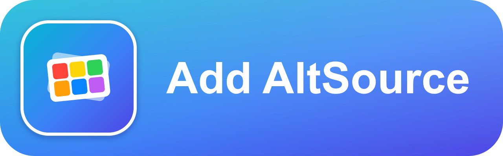
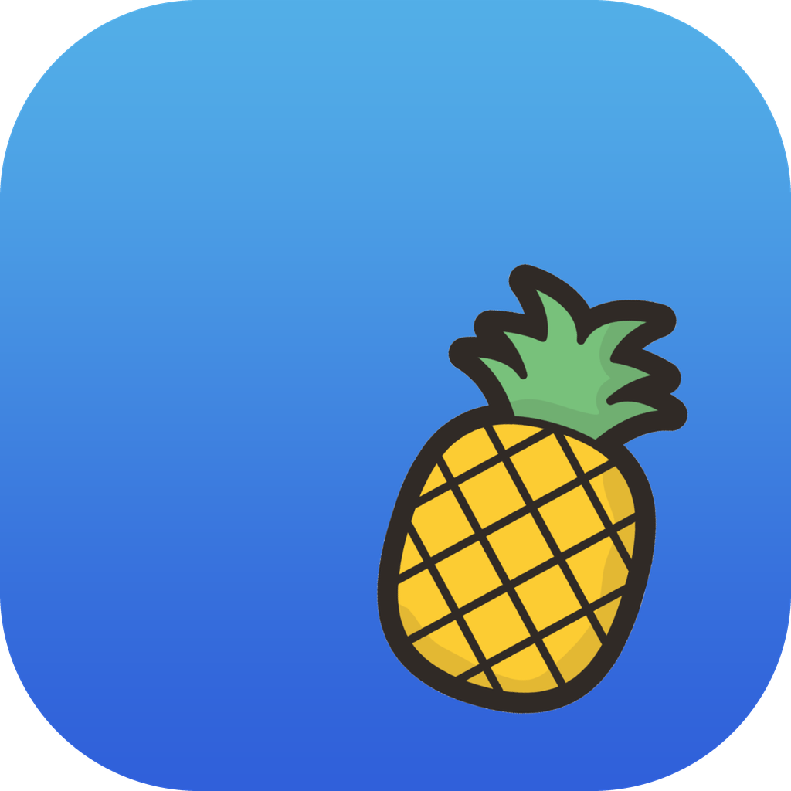
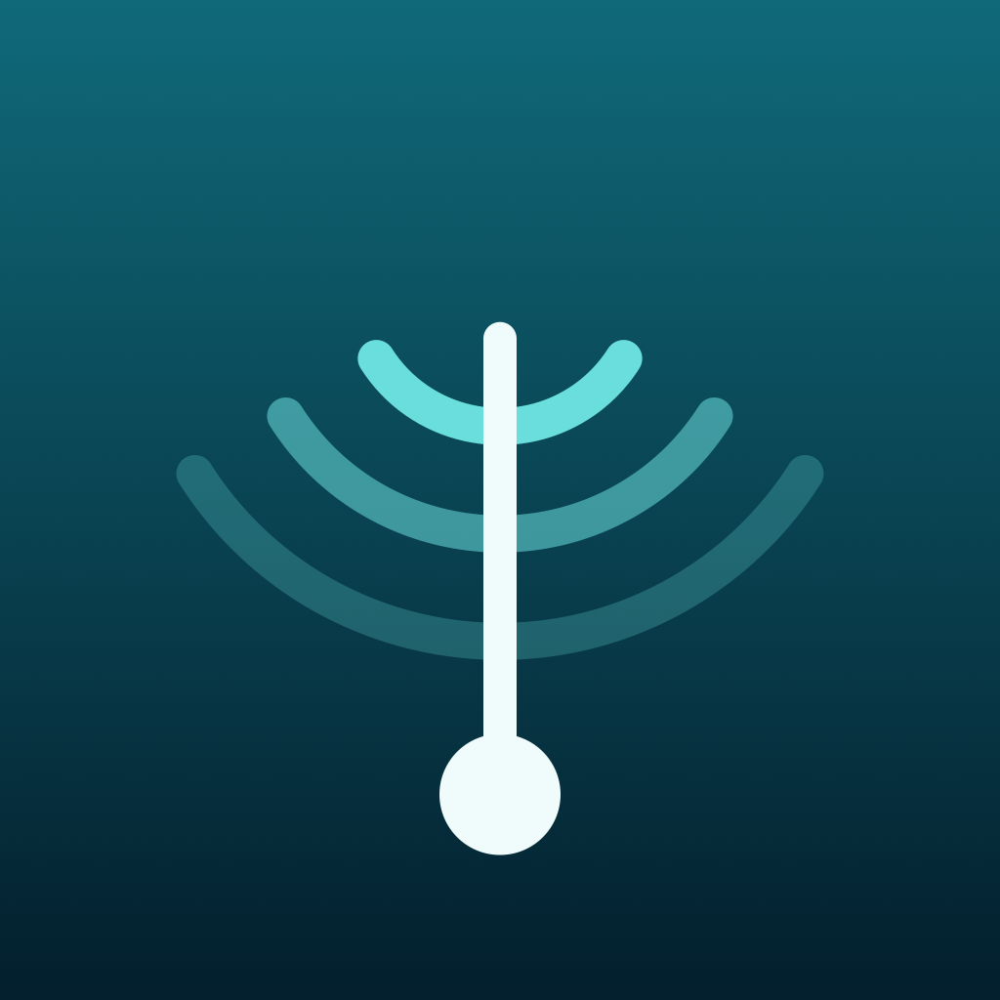
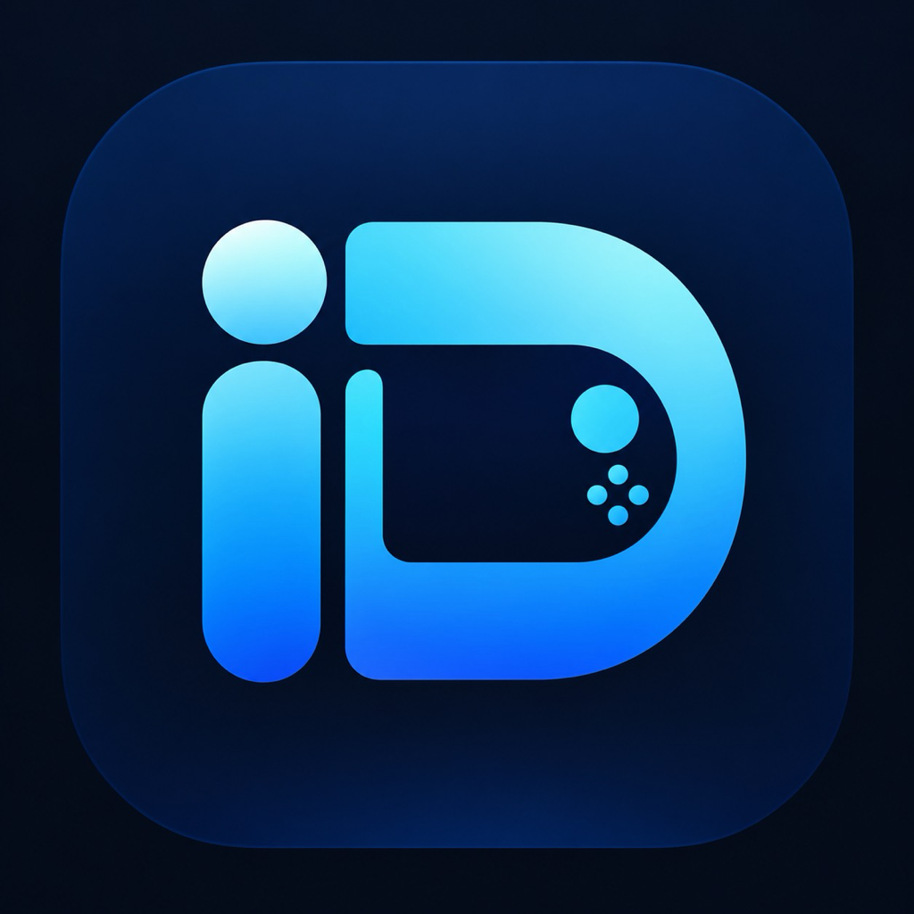
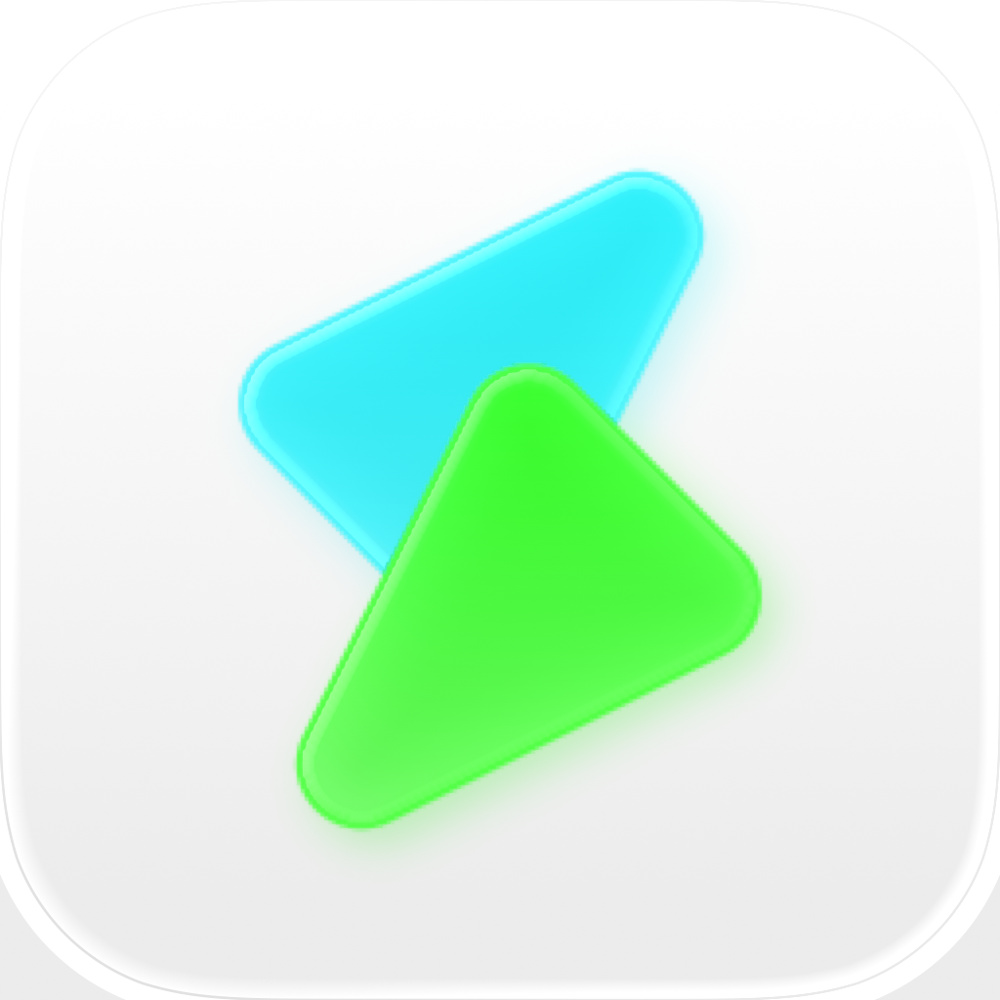
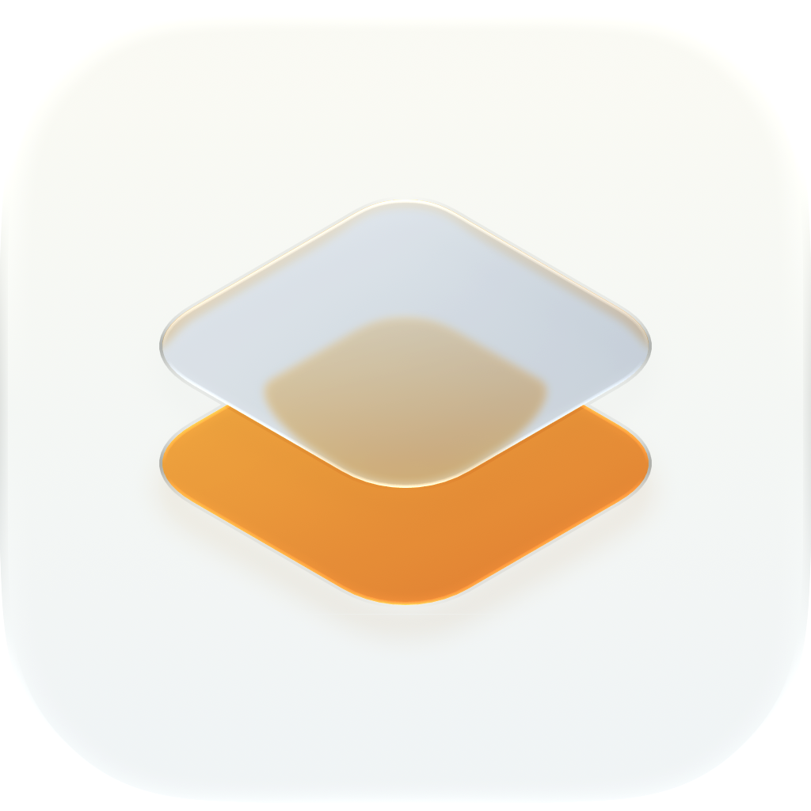
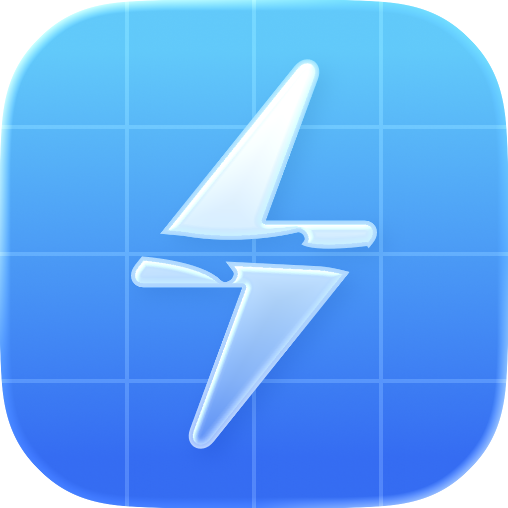

<p align="center">
  
</p>

<h1 align="center">AltGallery</h1>

<p align="center"><a href="README.md">English</a> | <b>简体中文</b></p>

<p>精选 AltStore 软件源：汇聚 GitHub 优质 IPA 开源项目。所有源均由 <a href="https://github.com/bebound/AltGen">AltGen</a> 生成。可用于 <a href="https://github.com/altstoreio/Altstore">AltStore</a>、<a href="https://github.com/SideStore/SideStore">SideStore</a>、<a href="https://github.com/LiveContainer/LiveContainer">LiveContainer</a>、<a href="https://github.com/claration/Feather">Feather</a> 或其他兼容应用。</p>

<p >在浏览器中浏览AltGallery：<a href="https://altgallery.fromkk.com/">altgallery.fromkk.com</a></p>

<p align="center">
<a href="https://altdirect.app/?url=https://raw.githubusercontent.com/bebound/AltGallery/refs/heads/master/all-apps.json" target="_blank">

</a>
</p>
<p align="center">（点击上方图片添加包含全部应用的 AltGallery 源。单个应用的源位于 <code>apps</code> 文件夹。）</p>
<p align="center">无法访问 <code>github.com</code>？请改用 <a href="https://altdirect.app/?url=https://gh-proxy.com/https://raw.githubusercontent.com/bebound/AltGallery/refs/heads/master/all-apps-proxy.json" target="_blank">gh-proxy 镜像</a>——所有资源均经由 gh-proxy.com 访问。</p>

## 请求添加应用

没找到想要的应用？[提交 issue](https://github.com/bebound/AltGallery/issues/new)，我会把它加入图库。请附上应用名称及其 GitHub 仓库链接（或 IPA / Release URL），以便我验证并添加。

## 截图

<table align="center" style="border: none; margin-left: auto; margin-right: auto;">
  <tr>
    <td align="center" style="border: none; padding: 6px;">
      
      <br><b>SideStore</b>
    </td>
    <td align="center" style="border: none; padding: 6px;">
      
      <br><b>SideStore News</b>
    </td>
    <td align="center" style="border: none; padding: 6px;">
      
      <br><b>LiveContainer</b>
    </td>
  </tr>
</table>

## 可用应用

###  <a href="https://github.com/Aidoku/Aidoku">Aidoku</a>
免费开源的 iOS 与 iPadOS 漫画阅读器——支持 WASM 扩展源、本地 CBZ、下载与 AniList/MyAnimeList 追番同步。

###  <a href="https://github.com/Mak5er/AirCard-iOS">AirCard-iOS</a>
Apple 钱包卡面、锁屏密码键盘主题与 PosterBoard 壁纸——在设备上直接应用，无需越狱。

###  <a href="https://github.com/altstoreio/AltStore">AltStore</a>
通过 AltServer 侧载未公证的应用——面向未越狱 iOS 设备的原创第三方应用商店。

###  <a href="https://github.com/AniBakaBaka/AniBaka">AniBaka</a>
跨平台番剧聚合、媒体播放与弹幕客户端——多番剧源、多弹幕、高清无广告，支持动漫实时超分辨率。

###  <a href="https://github.com/openAnimeFlow/AnimeFlow">AnimeFlow</a>
跨平台动漫视频播放器，支持多数据源、实时 4K 超分辨率与弹幕，并可与 Bangumi 同步追番。

###  <a href="https://github.com/open-ani/animeko">Animeko</a>
一站式弹幕追番平台，支持 Bangumi 云同步、多视频数据源聚合、离线缓存与弹幕云过滤。

###  <a href="https://github.com/Apollo-Reborn/Apollo-Reborn">Apollo Reborn</a>
带液态玻璃补丁的 Apollo-Reborn 版本——用你自己的 API Key，让 Apollo for Reddit 在 2023 年 6 月关停后继续可用。

###  <a href="https://github.com/ARMSX2/ARMSX2">ARMSX2</a>
面向 ARM64 的 PlayStation 2 模拟器——基于 PCSX2 的免费开源分支，带原生 JIT 重编译器。

###  <a href="https://github.com/Lakr233/Asspp">Asspp</a>
多区域 App Store 管理利器——即时切换商店区域、保留任意区域的官方 IPA 资料库，无需退出登录。

###  <a href="https://github.com/thebcd69/bcd-games">BCD</a>
iPhone 与 iPad 上的 Windows 游戏——由 Wine、FEX 与 Metal 驱动、内置 Steam 和 GOG 的快速手柄友好启动器。

###  <a href="https://github.com/AhmedBafkir/DLiPA">DLiPA</a>
下载、安装并分享 App Store 的 IPA——含历史版本，使用你自己的 Apple ID，无需越狱。

###  <a href="https://github.com/moliango/doer">Doer</a>
Linux.do 的原生 iOS 客户端。

###  <a href="https://github.com/OatmealDome/dolphin-ios">DolphiniOS</a>
iOS/iPadOS 的 GameCube 与 Wii 模拟器——基于全新 DolphiniOS 代码库的 Dolphin 移植版。

###  <a href="https://github.com/MaftyManicEMU/DukeX">DukeX</a>
iOS 上的初代 Xbox 模拟器，基于 xemu 构建并配有原生 Swift 界面。

###  <a href="https://github.com/EhPanda-Team/EhPanda">EhPanda</a>
使用 SwiftUI 与 TCA 构建的非官方 E-Hentai iOS 应用。

###  <a href="https://github.com/Kianuni/Erosion-CN">Erosion-CN</a>
iOS / iPadOS 系统配置与 MobileGestalt 研究工具箱——基于 worse_query，内置写入安全加固、应用前差异预览与原厂状态恢复。

###  <a href="https://github.com/Leviidev/Fathom">Fathom</a>
面向 iOS 的 x86-64 PC 模拟器——通过 FEXCore 在运行时将 x86-64 Linux 可执行文件转译为 ARM64 运行。需要 JIT，并在运行时附加调试器。

###  <a href="https://github.com/claration/feather">Feather</a>
设备端签名工具——用你自己的 Apple 开发者证书签名并安装 IPA，无需电脑。

###  <a href="https://github.com/huamidev/GestaltX">GestaltX</a>
面向 iOS 27 的 MobileGestalt 编辑器——区域代码调整、设备预设、能力开关与带类型的 plist 字段编辑器，支持备份。

###  <a href="https://github.com/pookjw/HermesEnabler">HermesEnabler</a>
在任意 Apple Watch 上启用 Hermès 表盘——另含 Ultra 表盘以及手表端显示、传感器与 Siri 调整。需要 watchOS 27.0–27.3 beta 1。

###  <a href="https://github.com/Leviidev/Husk">Husk</a>
iOS 上的 Android 应用启动器——放入 APK 轻点即全屏打开，需要 JIT 与附加调试器。

###  <a href="https://github.com/kuscholar/iDeck">iDeck</a>
iPhone 与 iPad 上的 Steam 大屏幕模式——通过 Madeira 运行时本地运行 Valve 客户端与兼容的 Windows 游戏。

###  <a href="https://github.com/mengangs/ipadn">iPadn</a>
下载 App Store 的历史版本与已下架应用——搜索并安装你已拥有的应用，支持区域价格比较与 11 种语言。

###  <a href="https://github.com/intraducine/iridium">Iridium</a>
实验性的 iPhone 与 iPad Windows 游戏运行时——把自有的游戏汇入一个资料库，用触控、手柄或键盘游玩。

###  <a href="https://github.com/XITRIX/iTorrent">iTorrent</a>
iOS 种子客户端。

###  <a href="https://github.com/Predidit/Kazumi">Kazumi</a>
基于自定义规则的番剧采集APP，支持流媒体在线观看、弹幕与实时超分辨率，使用 Flutter 实现。

###  <a href="https://github.com/LinkPass888/Kazumi-Swift">Kazumi-Swift</a>
基于自定义规则的番剧采集APP，支持流媒体在线观看、弹幕与实时超分辨率，使用 SwiftUI 实现。

###  <a href="https://github.com/Mac-XK/KMusic">KMusic</a>
基于 SwiftUI 的多源音乐聚合播放器，支持 iOS/macOS，内置酷我、酷狗、QQ 音乐、网易云等多平台音源与 LRC 歌词同步。

###  <a href="https://github.com/missuo/kumone">Kumone</a>
原生 NetEase Cloud Music iOS 客户端（雲の音），直连网易云音乐真实 API，支持灰色歌曲解锁与歌词。

###  <a href="https://github.com/LightNovelShelf/Flutter">LightNovelShelf</a>
轻书架官方 Flutter 客户端，支持书架管理、在线阅读与翻页动画。

###  <a href="https://github.com/mxhm11cr/LinuxRunner">LinuxRunner</a>
在 iOS 上运行 ARM64 Linux 应用与桌面——无需越狱、虚拟机或 JIT，桌面环境还可使用外接显示器。

###  <a href="https://github.com/LiveContainer/LiveContainer">LiveContainer+SideStore</a>
无需真正安装即可运行 iOS 应用！此版本内置 SideStore，用于续签你的应用。

###  <a href="https://github.com/lpfoj/lsx4">LSX4</a>
开源 PS4/PS5 模拟器——当前 iOS 版本可游玩 PS4 游戏，需要 iOS 26+ 与 JIT。

###  <a href="https://github.com/willfaust/Madeira">Madeira</a>
iPhone 上的 Windows PC 游戏——未经修改的 x86-64 游戏经 Wine、FEX-Emu 与 Metal 运行，无需越狱。

###  <a href="https://github.com/kodjodevf/mangayomi">Mangayomi</a>
阅读漫画、小说，观看番剧。

###  <a href="https://github.com/Manic-EMU/ManicEMU">ManicEMU</a>
面向 iOS 的一体化复古游戏模拟器，界面简洁，平台支持广泛。

###  <a href="https://github.com/youshen2/MeloX">MeloX</a>
使用 SwiftUI 开发的网易云音乐第三方客户端——面向 iPhone、iPad、Mac 与 Apple Watch 的原生播放器。

###  <a href="https://github.com/jxxghp/MoviePilot-App">MoviePilot</a>
MoviePilot 的 iOS 原生客户端——系统原生导航、搜索与快捷面板，业务页面复用 MoviePilot-Frontend，需要 iOS 16+ 和自有 MoviePilot 实例。

###  <a href="https://github.com/singleton-altman/MoviePilotLite">MoviePilotLite</a>
MoviePilot 移动端，基于 Flutter 实现。

###  <a href="https://github.com/dddevid/Musly">Musly</a>
免费的 Navidrome 客户端与 Subsonic 音乐播放器，采用 Apple Music 风格界面。

###  <a href="https://github.com/ResistanceTo/MiniWatts">MiniWatts</a>
电池、充电与温度测量工具——显示充电器的输出、有多少真正进入电芯、其余化为热量，以及手机上的每一个温度传感器。

###  <a href="https://github.com/mornyeapp/Mornye">Mornye</a>
支持下载的高解析音乐播放器——Flutter 与 Rust 打造，位完美输出、滚动歌词，还可从 SMB、WebDAV 或 Subsonic 串流。

###  <a href="https://github.com/verback2308/Opaline">Opaline</a>
面向 iOS 12+ 的 YouTube 客户端——轻量、注重隐私，支持 SponsorBlock、Return YouTube Dislike 与最高 1080p 播放。

###  <a href="https://github.com/hugeBlack/OpenParsec">OpenParsec</a>
面向 iOS/iPadOS 的开源 Parsec 客户端——支持鼠标、键盘与触屏。

###  <a href="https://github.com/MakrSas/orchard-ios">Orchard</a>
在 iPhone 应用里运行 Apple Silicon macOS Ventura——通过 Apple 自有链路启动真实 arm64 客户机，经由 Metal 绘制。

###  <a href="https://github.com/bggRGjQaUbCoE/PiliPlus">PiliPlus</a>
使用Flutter开发的BiliBili第三方客户端。

###  <a href="https://github.com/Eslzzyl/Pixiv-SwiftUI">Pixiv-SwiftUI</a>
基于 SwiftUI 的 Pixiv 第三方客户端，支持 iOS/iPadOS/macOS。

###  <a href="https://github.com/playportdev/playport">Playport</a>
iPhone 上的 PC 游戏，原生运行、无需串流——64 位与 32 位 Windows 游戏跑在手机自己的 CPU 与 GPU 上。

###  <a href="https://github.com/xmiguel911x/PSX3IOS">PSX3IOS</a>
面向 iPhone 与 iPad 的 PlayStation 3 模拟器——基于 RPCS3，支持社区补丁、成就、游玩时长与存档数据。

###  <a href="https://github.com/liuchuancong/pure_live">PureLive</a>
基于 Flutter 的开源多平台直播聚合播放器，支持 Bilibili、虎牙、斗鱼、快手、抖音、网易 CC、Twitch 及自定义 M3U/M3U8 直播源。

###  <a href="https://github.com/TarbleFR/RewindBox">RewindBox</a>
iPhone 与 iPad 的模拟器前端——基于 NeoStation 的分支，主机风格资料库搭配 Libretro 核心、Dolphin、ARMSX2、MeloNX 与 RPCS3。

###  <a href="https://github.com/seanhowarthdev/Roam-Control">Roam Control</a>
选择、测试并移动 iPhone 上报的位置——在统一的 Apple 地图界面里模拟步行路线、保存收藏。

###  <a href="https://github.com/ekomlenovic/rush_hour_ios_android">Rush Hours</a>
移动车辆，让红色小车脱身。免费滑块解谜，700+ 关卡世界地图、每日与每周挑战、关卡编辑器与多人模式。

###  <a href="https://github.com/donbytyqi/scenebox">SceneBox</a>
面向 iOS、iPadOS、tvOS 与 Mac（Catalyst）的种子串流客户端，使用 SwiftUI 编写。

###  <a href="https://github.com/SideStore/SideStore">SideStore</a>
面向 iOS 的免数据线第三方应用商店——用个人 Apple ID 重签名并安装 IPA，并在后台自动续签，无需 AltServer。

###  <a href="https://github.com/akinal5765-byte/Silverphase">Silverphase</a>
面向 iPhone 与 iPad 的原生胶片与印相模拟器——选好胶片与相纸，再从曝光、显影一路塑形到扫描。

###  <a href="https://github.com/ishtiaq156/stats">Stats</a>
一眼看到 Mac 的状态——通过加密的本地连接查看系统活动，配轻量的 Mac 端。

###  <a href="https://github.com/StikDebug/StikDebug">StikDebug</a>
面向 iOS 17.4+ 的在设备端 JIT 启用工具与设备工具箱，基于 idevice 构建。

###  <a href="https://github.com/swipt-automation/swipt">Swipt</a>
通用 iOS 自动化平台——JavaScript swiplet、TypeScript SDK 与兼容 MCP 的 API。

###  <a href="https://github.com/infinityf4p/TiebaPure-iOS">TiebaPure</a>
基于 SwiftUI 的第三方百度贴吧客户端——支持 iOS 16.4+，可浏览、搜索、收藏、查看媒体与本地阅读记录。

###  <a href="https://github.com/Suwayomi/Suwayomi-Tsumiru">Tsumiru</a>
面向 Suwayomi-Server 的原生漫画与条漫阅读器——离线下载、设备端目录与重构的连续滚动阅读器。

###  <a href="https://github.com/utmapp/UTM">UTM</a>
iOS 上的虚拟机——在 iPhone 与 iPad 上运行 Windows、Android 等，支持 30 多种处理器与 JIT 加速。

###  <a href="https://github.com/CyrilPeng/Venera-Next">VeneraNext</a>
跨平台漫画阅读器——基于 Flutter，支持本地漫画、WebDAV 漫画源与第三方网络漫画源。

###  <a href="https://github.com/kolbicz/WQFiles">WQ Files</a>
面向 iOS 26 与 27 的文件管理器（worse_query）——浏览其他 App 的容器、编辑 plist/十六进制/SQLite，备份或清除数据，无需越狱。

###  <a href="https://github.com/Kianuni/WQGuard">WQGuard</a>
iOS 沙盒越权检测与侧载 IPA 审查工具——面向 iOS 26.2+ / iOS 27.x 的只读沙盒逃逸检测、Mach-O 静态审计与固件 CVE 防护。

###  <a href="https://github.com/MchinaMd57764/WQToolkit">WQToolkit</a>
基于 App Group 容器查询原语的 iOS 工具箱——无需越狱即可浏览、清理与检查自己的应用数据容器，内置文件浏览器、缓存扫描与设备信息。

###  <a href="https://github.com/mrdrvt99/YouProEXTRA">YouProEXTRA</a>
可自定义调整项的 YouTube 修改版——把 YouPro、YTLite 等模块打包进一个 IPA 构建工具。

###  <a href="https://github.com/huamurui/zhihu-minus-minus">ZhihuMinusMinus</a>
轻量、纯净的第三方知乎客户端，基于 React Native (Expo) 构建，无广告，支持多账号切换、游客模式与深色模式。

## 项目结构

```
AltGallery/
├── assets/               # 共享资源：应用图标、“Add AltSource” 按钮、README 截图
│   ├── icon.svg / icon.png
│   ├── add-alt-source.svg / add-alt-source.png
│   └── *.jpg             # README 截图（SideStore、SideStore News、LiveContainer）
├── tools/                # 辅助脚本
│   ├── render_news.py    # 共享资讯图片渲染器
│   ├── ipa_icon.py       # 从 Release .ipa 中提取应用图标
│   └── ipa_bundle_id.py  # 从 Release .ipa 中读取 bundle id / 版本
├── apps/                 # 每个应用一个文件夹
│   └── <AppName>/
│       ├── config.toml   # altgen 配置
│       ├── news.toml     # 资讯图片配置（name、tagline，可选 colors）
│       ├── icon.png      # 资源文件放在这里
│       ├── images/       # 截图 + news.png 宣传图
│       └── apps.json     # 生成的 AltStore 源
└── ...
```

## Star 历史

<a href="https://www.star-history.com/?repos=bebound%2Faltgallery&type=date&legend=top-left">
 <picture>
   <source media="(prefers-color-scheme: dark)" srcset="https://api.star-history.com/chart?repos=bebound/altgallery&type=date&theme=dark&legend=top-left" />
   <source media="(prefers-color-scheme: light)" srcset="https://api.star-history.com/chart?repos=bebound/altgallery&type=date&legend=top-left" />
   
 </picture>
</a>
